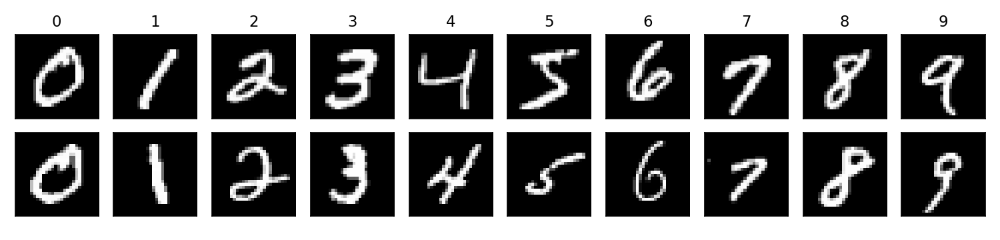
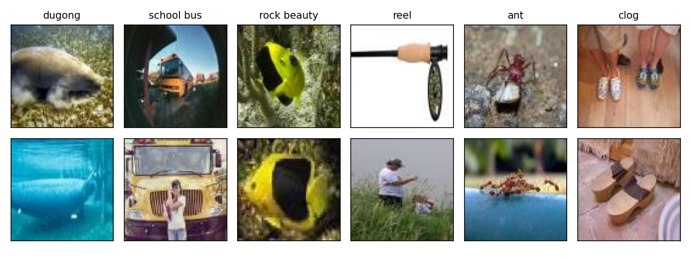
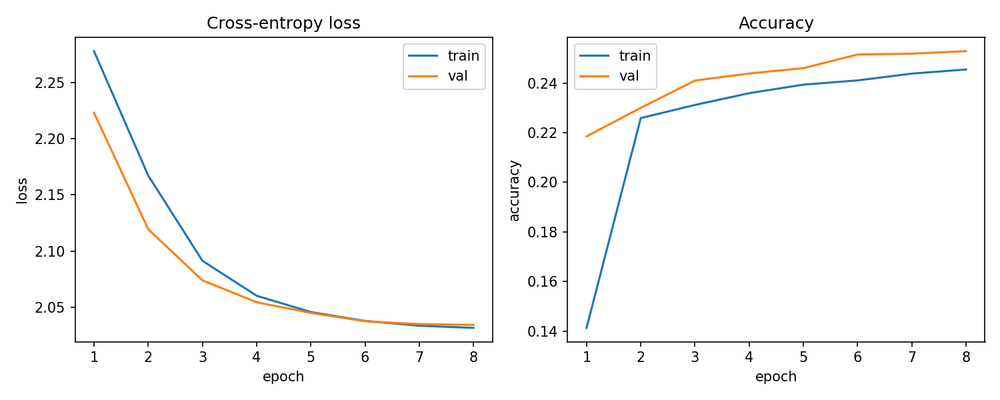
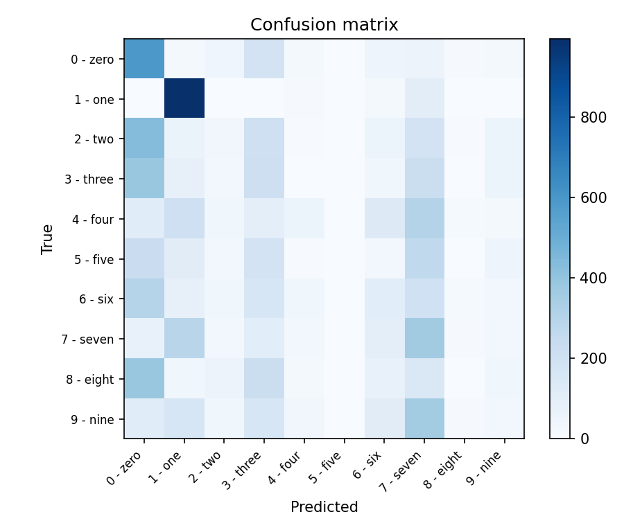
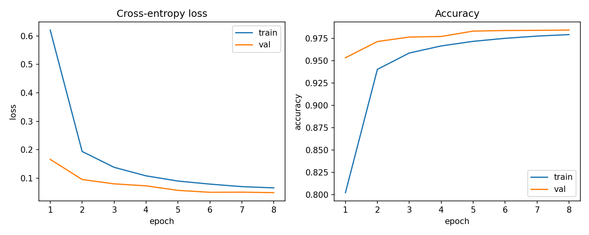
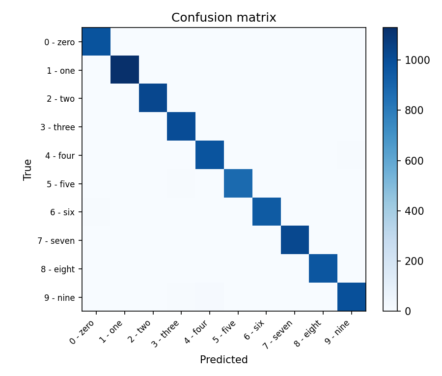
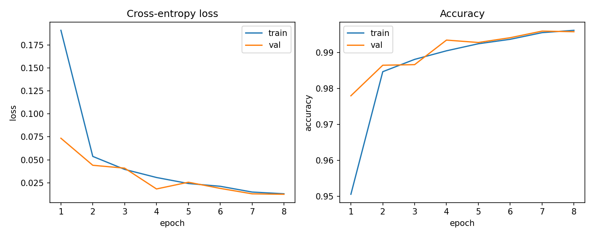
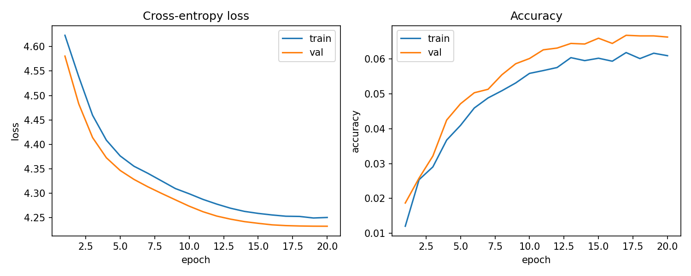
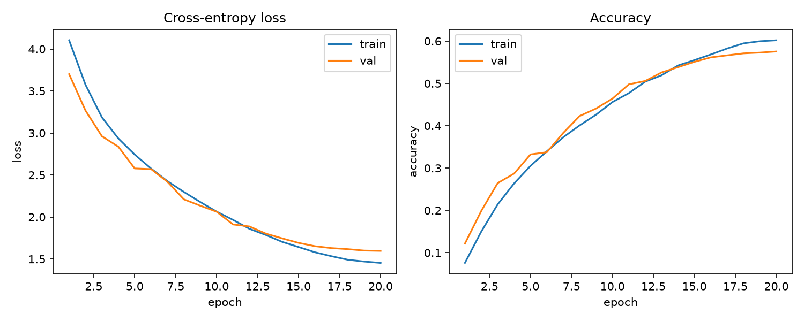

# 课程报告：卷积神经网络分类

## 1 任务描述

1. 基于 MNIST 数据集，设计并实现卷积神经网络分类器。TinyCNN 只有一层卷积，作为更弱的对照；LeNet 是两层卷积加全连接；SmallCNN 用三组 3×3 卷积、批归一化和全局平均池化。三个网络看同一批 28×28 的手写数字，训练设置相同。
2. 基于 ImageNet mini，用同一个 TinyCNN 和带残差连接的 MiniResNet 做 100 类自然图像分类。官方压缩包按少样本学习分成 64、16、20 个互斥类别。本次把它合并成普通的 100 类分类，再按类别重新划分训练、验证和测试。两个网络用同一次划分。

## 2 数据描述

MNIST 是手写数字数据集，共 10 类（0–9）。训练集 60000 张，测试集 10000 张，图像为 $28\times 28$ 灰度图，像素取值 0–255。笔画取值高，背景接近 0。数据由 torchvision 读取。

下图是训练集里每个数字的前两张。同一类的写法并不固定：0 有的圆、有的扁；1 有的细、有的带钩；2 有的折角明显、有的弯成一圈；4 有的开口、有的封口；7 的横笔可有可无。卷积在局部窗口上共享同一组权重，这些不同写法仍进入同一组卷积核。



ImageNet mini 使用 Ravi 与 Larochelle 的划分，共 100 类，每类 600 张 $84\times 84$ 彩色图，合计 60000 张。压缩包解压后是 `train/`、`val/`、`test/` 三个目录，分别有 64、16、20 个类别，三个目录的类别互不重叠。这是少样本学习的划分：验证集和测试集里的类别在训练集中没有出现，不能直接拿来衡量 100 类分类器。

下图每列一类，上面是该类的一张图，下面是另一张。儒艮都在水下，但水色和距离不同；校车有的被鱼眼镜头包住，有的正对镜头；岩美鱼的黄黑块很稳，背景却从珊瑚换成深色。卷轴有的是白底上的渔轮特写，有的画面主体是草地上的人，轮子很小。蚂蚁有的占满画面，有的只是管子上的几个小点。木屐有的是鞋的特写，有的画面里主要是脚和另一双鞋。同一类里物体的尺度、背景和是否成为主体都不固定。



## 3 数据预处理

MNIST：

- 像素经 `ToTensor` 转到 $[0,1]$，再用均值 0.1307、标准差 0.3081 标准化。
- 训练集做轻微随机仿射，旋转 $\pm 8^\circ$，平移不超过边长的 8%。验证集和测试集不做这步。多层感知机和支持向量机的实验没有做这步增强，划分和测试集与它们相同。
- 从训练集中按 9:1 划出验证集（54000 / 6000），测试集保持官方的 10000 张。划分用种子 42 的随机排列。

```python
train_tf = transforms.Compose([
    transforms.RandomAffine(degrees=8, translate=(0.08, 0.08)),
    transforms.ToTensor(),
    transforms.Normalize((0.1307,), (0.3081,)),
])
eval_tf = transforms.Compose([
    transforms.ToTensor(),
    transforms.Normalize((0.1307,), (0.3081,)),
])

n_val = int(len(full_train) * 0.1)
generator = torch.Generator().manual_seed(42)
perm = torch.randperm(len(full_train), generator=generator).tolist()
val_idx, train_idx = perm[:n_val], perm[n_val:]
```

ImageNet mini：

- 先把 `train/`、`val/`、`test/` 里的图片按类别名合并，得到 100 类、每类 600 张。再对每一类用种子 42 打乱，按 8:1:1 分成训练、验证、测试，分别是 48000、6000、6000 张。100 个类别在三个集合里都出现。
- 训练时做随机裁剪、水平翻转和颜色抖动。验证和测试先把短边放大到 $84\times 1.15$，再中心裁剪到 $84\times 84$。
- 像素按 ImageNet 的均值 $(0.485, 0.456, 0.406)$ 和标准差 $(0.229, 0.224, 0.225)$ 标准化。

```python
def stratified_classification_split(groups, seed):
    classes = sorted(groups)
    class_to_idx = {name: i for i, name in enumerate(classes)}
    rng = random.Random(seed)
    train_samples, val_samples, test_samples = [], [], []
    for name in classes:
        files = groups[name][:]
        rng.shuffle(files)
        n = len(files)
        n_test = max(1, int(round(n * 0.1)))
        n_val = max(1, int(round(n * 0.1)))
        label = class_to_idx[name]
        test_samples.extend((path, label) for path in files[:n_test])
        val_samples.extend((path, label) for path in files[n_test:n_test + n_val])
        train_samples.extend((path, label) for path in files[n_test + n_val:])
    return classes, train_samples, val_samples, test_samples


train_tf = transforms.Compose([
    transforms.RandomResizedCrop(84, scale=(0.7, 1.0)),
    transforms.RandomHorizontalFlip(),
    transforms.ColorJitter(brightness=0.2, contrast=0.2, saturation=0.2),
    transforms.ToTensor(),
    transforms.Normalize((0.485, 0.456, 0.406), (0.229, 0.224, 0.225)),
])
eval_tf = transforms.Compose([
    transforms.Resize(int(84 * 1.15)),
    transforms.CenterCrop(84),
    transforms.ToTensor(),
    transforms.Normalize((0.485, 0.456, 0.406), (0.229, 0.224, 0.225)),
])
```

## 4 算法介绍

卷积层在局部窗口上计算输出，同一张特征图的每个位置共用同一组核。设输入通道为 $c$，核的高宽为 $k$，输出位置 $(i,j)$ 的一个通道是

$$
y_{ij}=\sum_{c}\sum_{u=0}^{k-1}\sum_{v=0}^{k-1} W_{cuv}\,x_{c,\,i+u,\,j+v}+b.
$$

核在整张图上平移，所以参数量不随图像边长增加，只随通道数和核大小增加。填充为 $P$、步长为 $S$ 时，输出边长是

$$
\left\lfloor\frac{H+2P-k}{S}\right\rfloor+1.
$$

池化层没有可学习参数。平均池化取窗口内的均值，最大池化取窗口内的最大值。全局平均池化把每张特征图收成一个数，后面的线性层只看见通道，不看见空间位置。

隐藏层用 ReLU，负的激活被截成 0：

$$
\mathrm{ReLU}(u)=\max(u,0).
$$

批归一化用当前 batch 的均值 $\mu_B$ 和方差 $\sigma_B^2$ 把激活拉回稳定范围，再乘可学习的缩放 $\gamma$、加上偏移 $\beta$：

$$
\mathrm{BN}(h)=\gamma\frac{h-\mu_B}{\sqrt{\sigma_B^2+\epsilon}}+\beta.
$$

Dropout 在训练时把隐藏单元以概率 $p$ 置成 0，预测时关闭。四个网络的最后一层都输出 logits，不加激活。TinyCNN 和 LeNet 没有 Dropout。训练目标是交叉熵。设 logits 为 $z$，真实类别为 $y$，类别数为 $K$，

$$
\ell(z,y)=-\log\frac{e^{z_y}}{\sum_{k=1}^{K}e^{z_k}}.
$$

预测取 $\arg\max_k z_k$。优化器是 AdamW，学习率 $10^{-3}$，权重衰减 $10^{-4}$。学习率按余弦退火下降：

$$
\eta_t=\frac12\eta\bigl(1+\cos(\pi t/T)\bigr).
$$

MNIST 的 $T=8$，ImageNet mini 的 $T=20$。batch size 都是 128。验证准确率更高时才覆盖已保存的权重，测试集只在选完之后评估一次。训练准确率在 Dropout 打开、并且训练集还带着数据增强时统计。

```python
def run_epoch(model, loader, criterion, device, optimizer=None):
    training = optimizer is not None
    model.train(training)
    total_loss, correct, total = 0.0, 0, 0
    context = torch.enable_grad() if training else torch.no_grad()
    with context:
        for images, labels in loader:
            images = images.to(device)
            labels = labels.to(device)
            logits = model(images)
            loss = criterion(logits, labels)
            if training:
                optimizer.zero_grad(set_to_none=True)
                loss.backward()
                optimizer.step()
            total_loss += loss.item() * images.size(0)
            correct += (logits.argmax(dim=1) == labels).sum().item()
            total += images.size(0)
    return total_loss / total, correct / total


criterion = nn.CrossEntropyLoss()
optimizer = torch.optim.AdamW(model.parameters(), lr=1e-3, weight_decay=1e-4)
scheduler = torch.optim.lr_scheduler.CosineAnnealingLR(optimizer, T_max=epochs)
best_acc = -1.0
for epoch in range(1, epochs + 1):
    run_epoch(model, train_loader, criterion, device, optimizer)
    _, val_acc = run_epoch(model, val_loader, criterion, device)
    scheduler.step()
    if val_acc > best_acc:
        best_acc = val_acc
        torch.save({"model": model.state_dict()}, best_path)
```

**TinyCNN（较弱的baseline）**

输入通道数和类别数随数据集改变，其余结构不变。只有 4 个 $3\times 3$ 卷积核，填充为 1，边长不变，再接 ReLU 和 $2\times 2$ 最大池化。全局平均池化把每张特征图收成一个数，线性层只看见这 4 个数。没有第二层卷积，没有批归一化，没有 Dropout，也没有残差。

MNIST 上参数量是

$$
(1\cdot 3\cdot 3+1)\cdot 4+4\cdot 10+10=90.
$$

ImageNet mini 上是

$$
(3\cdot 3\cdot 3+1)\cdot 4+4\cdot 100+100=612.
$$

LeNet 有 44426 个参数，大约是这个网络在 MNIST 上的 494 倍。MiniResNet 有 2,820,740 个参数，大约是它在 ImageNet mini 上的 4609 倍。全局平均池化丢掉了笔画和物体在图中的位置，分类器只能根据 4 个通道的平均响应做判断。

```python
class TinyCNN(nn.Module):
    def __init__(self, in_channels=1, num_classes=10, channels=4):
        super().__init__()
        self.features = nn.Sequential(
            nn.Conv2d(in_channels, channels, kernel_size=3, padding=1),
            nn.ReLU(inplace=True),
            nn.MaxPool2d(kernel_size=2, stride=2),
            nn.AdaptiveAvgPool2d(1),
        )
        self.fc = nn.Linear(channels, num_classes)

    def forward(self, x):
        x = self.features(x)
        return self.fc(torch.flatten(x, 1))
```

**LeNet（MNIST 基线）**

输入是 $1\times 28\times 28$。第一层是 $5\times 5$ 卷积，6 个通道，输出 $6\times 24\times 24$，再接 ReLU 和 $2\times 2$ 平均池化，得到 $6\times 12\times 12$。第二层同样是 $5\times 5$ 卷积，16 个通道，输出 $16\times 8\times 8$，池化后是 $16\times 4\times 4$。拉平后经 $256\to 120\to 84\to 10$ 三层全连接，中间两层用 ReLU。激活函数用 ReLU，其余结构和 LeNet-5 一致。没有批归一化，也没有 Dropout。

参数量是

$$
(1\cdot 5\cdot 5+1)\cdot 6+(6\cdot 5\cdot 5+1)\cdot 16+256\cdot 120+120+120\cdot 84+84+84\cdot 10+10=44426.
$$

```python
class LeNet(nn.Module):
    def __init__(self, num_classes=10):
        super().__init__()
        self.features = nn.Sequential(
            nn.Conv2d(1, 6, kernel_size=5),
            nn.ReLU(inplace=True),
            nn.AvgPool2d(kernel_size=2, stride=2),
            nn.Conv2d(6, 16, kernel_size=5),
            nn.ReLU(inplace=True),
            nn.AvgPool2d(kernel_size=2, stride=2),
        )
        self.classifier = nn.Sequential(
            nn.Flatten(),
            nn.Linear(16 * 4 * 4, 120),
            nn.ReLU(inplace=True),
            nn.Linear(120, 84),
            nn.ReLU(inplace=True),
            nn.Linear(84, num_classes),
        )

    def forward(self, x):
        return self.classifier(self.features(x))
```

**SmallCNN（MNIST 主模型）**

一组卷积块是两层 $3\times 3$ 卷积。卷积没有偏置，后面接 BatchNorm 和 ReLU，块的末尾用 $2\times 2$ 最大池化把边长减半。填充为 1，所以卷积本身不改变边长。三组的通道是 $1\to 32\to 64\to 128$，空间尺寸是 $28\to 14\to 7\to 3$。全局平均池化把 $128\times 3\times 3$ 收成 128 维，Dropout 概率 0.3，再线性映射到 10 类。

一组从 $C_{\mathrm{in}}$ 到 $C_{\mathrm{out}}$ 的参数量是 $9C_{\mathrm{out}}(C_{\mathrm{in}}+C_{\mathrm{out}})+4C_{\mathrm{out}}$。三组加上最后一层是

$$
9632+55552+221696+(128\cdot 10+10)=288170.
$$

全局平均池化之后，分类层的大小只由通道数决定。把输入通道改成 3、类别数改成 100，同一结构也可以接到别的分辨率上。本次 ImageNet mini 没有用它，用的是下面的残差网络。

```python
class ConvBlock(nn.Module):
    def __init__(self, in_channels, out_channels):
        super().__init__()
        self.block = nn.Sequential(
            nn.Conv2d(in_channels, out_channels, kernel_size=3, padding=1, bias=False),
            nn.BatchNorm2d(out_channels),
            nn.ReLU(inplace=True),
            nn.Conv2d(out_channels, out_channels, kernel_size=3, padding=1, bias=False),
            nn.BatchNorm2d(out_channels),
            nn.ReLU(inplace=True),
            nn.MaxPool2d(kernel_size=2, stride=2),
        )

    def forward(self, x):
        return self.block(x)


class SmallCNN(nn.Module):
    def __init__(self, in_channels=1, num_classes=10, width=32, dropout=0.3):
        super().__init__()
        self.features = nn.Sequential(
            ConvBlock(in_channels, width),
            ConvBlock(width, width * 2),
            ConvBlock(width * 2, width * 4),
        )
        self.head = nn.Sequential(
            nn.AdaptiveAvgPool2d(1),
            nn.Flatten(),
            nn.Dropout(dropout),
            nn.Linear(width * 4, num_classes),
        )

    def forward(self, x):
        return self.head(self.features(x))
```

**MiniResNet（ImageNet mini）**

残差块把卷积的输出加回输入。步长为 1 且通道数不变时，捷径是恒等映射；否则用 $1\times 1$ 卷积把捷径的通道和分辨率对齐：

$$
y=\mathrm{ReLU}\bigl(F(x)+S(x)\bigr).
$$

$F$ 是两层 $3\times 3$ 卷积，中间有 BatchNorm 和 ReLU，第二层卷积之后先相加再做 ReLU。

茎部是 $3\times 3$、步长 1 的卷积，把 3 通道扩到 32，边长仍是 84。四个阶段的通道是 32、64、128、256，每阶段两个残差块。后三个阶段的第一块步长为 2，边长减半。全局平均池化后接 Dropout（0.2）和线性层，输出 100 类。可训练参数 2,820,740。茎部不用 $7\times 7$、步长 2 的卷积，避免 $84\times 84$ 的图在第一层就被压到一半。

```python
class ResidualBlock(nn.Module):
    def __init__(self, in_channels, out_channels, stride=1):
        super().__init__()
        self.conv1 = nn.Conv2d(in_channels, out_channels, 3, stride=stride, padding=1, bias=False)
        self.bn1 = nn.BatchNorm2d(out_channels)
        self.conv2 = nn.Conv2d(out_channels, out_channels, 3, padding=1, bias=False)
        self.bn2 = nn.BatchNorm2d(out_channels)
        if stride != 1 or in_channels != out_channels:
            self.shortcut = nn.Sequential(
                nn.Conv2d(in_channels, out_channels, 1, stride=stride, bias=False),
                nn.BatchNorm2d(out_channels),
            )
        else:
            self.shortcut = nn.Identity()

    def forward(self, x):
        out = F.relu(self.bn1(self.conv1(x)), inplace=True)
        out = self.bn2(self.conv2(out))
        return F.relu(out + self.shortcut(x), inplace=True)


class MiniResNet(nn.Module):
    def __init__(self, in_channels=3, num_classes=100, dropout=0.2):
        super().__init__()
        self.stem = nn.Sequential(
            nn.Conv2d(in_channels, 32, 3, stride=1, padding=1, bias=False),
            nn.BatchNorm2d(32),
            nn.ReLU(inplace=True),
        )
        self.layer1 = self._make_stage(32, 32, 2, stride=1)
        self.layer2 = self._make_stage(32, 64, 2, stride=2)
        self.layer3 = self._make_stage(64, 128, 2, stride=2)
        self.layer4 = self._make_stage(128, 256, 2, stride=2)
        self.pool = nn.AdaptiveAvgPool2d(1)
        self.dropout = nn.Dropout(dropout)
        self.fc = nn.Linear(256, num_classes)

    @staticmethod
    def _make_stage(in_channels, out_channels, n_blocks, stride):
        blocks = [ResidualBlock(in_channels, out_channels, stride=stride)]
        for _ in range(1, n_blocks):
            blocks.append(ResidualBlock(out_channels, out_channels, stride=1))
        return nn.Sequential(*blocks)

    def forward(self, x):
        x = self.stem(x)
        x = self.layer1(x)
        x = self.layer2(x)
        x = self.layer3(x)
        x = self.layer4(x)
        x = torch.flatten(self.pool(x), 1)
        return self.fc(self.dropout(x))
```

## 5 实验结果及分析

设备为 Apple MPS。

### 5.1 MNIST

#### 5.1.1 主实验

| 模型 | 参数量 | 最佳验证准确率 | 测试准确率 |
| --- | ---: | ---: | ---: |
| TinyCNN | 90 | 0.2528 | 0.2384 |
| LeNet | 44,426 | 0.9842 | 0.9895 |
| SmallCNN | 288,170 | 0.9960 | 0.9964 |

TinyCNN 的验证准确率在第 8 个 epoch 最高，为 0.2528。测试集 10000 张上的准确率是 0.2384，分错 7616 张。10 类均匀猜测的准确率是 0.10，交叉熵是 $\ln 10\approx 2.303$。验证损失从 2.223 降到 2.035，仍接近 $\ln 10$。数字 1 的 f1 最高（0.6270），1135 张里对了 995 张。数字 5 的 f1 是 0，892 张全错，测试集上一次都没有被预测成 5。数字 8 只对了 2 张，f1 是 0.0039。预测次数最多的是 0，共 2620 次，其中对的只有 591 次。

下图左图是交叉熵，右图是准确率。横轴都是 epoch。蓝线是训练集，橙线是验证集。这个网络没有 Dropout。训练集做了随机旋转和平移，验证集没有。



训练损失从 2.278 降到 2.032，训练准确率从 0.141 升到 0.245。验证准确率从 0.2185 升到 0.2528，后四个 epoch 只增加了约 0.009。两条曲线在第 3 个 epoch 之后几乎走平。测试用的是第 8 个 epoch 的权重。

下一张是 TinyCNN 在测试集上的混淆矩阵。行是真实数字，列是预测数字，颜色越深计数越大。



对角线不再是最深的。2 这一行有 432 张被分成 0，8 有 384 张分成 0，3 有 381 张分成 0。9 有 356 张分成 7，4 有 306 张分成 7，6 有 301 张分成 0。数字 5 的 263 张分成 7，227 张分成 0。网络把大部分样本收成 0、1、3、7 这四类。一层卷积再做全局平均之后，分类器看不见笔画落在图的哪一块，只能看 4 个通道的平均强度。

LeNet 的验证准确率在第 8 个 epoch 最高，为 0.9842。测试集 10000 张上的准确率是 0.9895，分错 105 张。数字 1 的 f1 最高（0.9960），数字 9 最低（0.9831），数字 5 次低（0.9865）。数字 9 错 20 张，其中 9 张分成 4，5 张分成 3。数字 5 错 17 张，其中 7 张分成 3，4 张分成 9。数字 6 错 15 张，其中 6 张分成 0。数字 4 错 9 张，其中 6 张分成 9。最多的单格混淆是 9→4，9 张。

下图的画法和 TinyCNN 相同。这个网络没有 Dropout。训练集做了随机旋转和平移，验证集没有。



训练损失从 0.620 降到 0.066，验证损失从 0.166 降到 0.049。前两个 epoch 下降很快，后面变慢。训练准确率从 0.802 升到 0.979，验证准确率从 0.953 升到 0.984。八个 epoch 里训练准确率都低于验证集，训练损失都高于验证集。训练集每个 epoch 都在做随机仿射，统计的是增强后的样本；验证集是原图。测试用的是第 8 个 epoch 的权重。

下一张是 LeNet 的测试集混淆矩阵，读法与上面相同。



颜色集中在对角线上。对角线以外的计数都在 10 张以内，看得清的是 9 这一行在 4 上、5 这一行在 3 上。多层感知机的线性分类器里，2→8 有 35 张、5→3 有 33 张；这里 5→3 是 7 张，2→8 只有 1 张。

SmallCNN 的最佳验证准确率出现在第 7 个 epoch，为 0.9960。测试集 10000 张上的准确率是 0.9964，分错 36 张，比 LeNet 少 69 张。数字 4 的 f1 最高（0.9980），数字 5 最低（0.9933），数字 6 次低（0.9948）。数字 1 的 1135 张全部正确。错得最多的是数字 6，9 张；数字 3 和 7 各 5 张；数字 2、5、8 各 4 张；数字 4 和 9 各 2 张；数字 0 只错 1 张。

下图的画法和 LeNet 相同。训练准确率在 Dropout 打开、并且训练集带随机仿射时统计。



左图里两条损失在前两个 epoch 从 0.19、0.07 降到 0.05 附近，之后贴在一起缓缓下降。训练损失从 0.191 降到 0.013，验证损失从 0.073 降到 0.013。第 4 个 epoch 验证损失降到 0.018，第 5 个 epoch 回到 0.026，第 7、8 个 epoch 又降到 0.013。右图里训练准确率从 0.951 升到 0.996，验证准确率从 0.978 升到第 7 个 epoch 的 0.9960，第 8 个 epoch 为 0.9958。第 8 个 epoch 训练准确率 0.9962，略高于验证集。测试用的是第 7 个 epoch 的权重。

下一张是 SmallCNN 的测试集混淆矩阵。


对角线比 LeNet 更齐，非对角线几乎看不出颜色。10000 张里只有 36 张不在对角线上。数字 6 一共错 9 张，是错得最多的一类；数字 9 一共错 2 张。

各类 f1 如下。

| 数字 | TinyCNN | LeNet | SmallCNN |
| ---: | ---: | ---: | ---: |
| 0 | 0.3283 | 0.9909 | 0.9975 |
| 1 | 0.6270 | 0.9960 | 0.9978 |
| 2 | 0.0471 | 0.9927 | 0.9961 |
| 3 | 0.1663 | 0.9892 | 0.9955 |
| 4 | 0.1000 | 0.9883 | 0.9980 |
| 5 | 0.0000 | 0.9865 | 0.9933 |
| 6 | 0.1253 | 0.9890 | 0.9948 |
| 7 | 0.2229 | 0.9903 | 0.9961 |
| 8 | 0.0039 | 0.9877 | 0.9969 |
| 9 | 0.0468 | 0.9831 | 0.9975 |

从 TinyCNN 到 LeNet，十个数字的 f1 都上升。抬得最多的是 5（+0.9865）和 8（+0.9838），这两类在单层网络里几乎没有被分开。再从 LeNet 到 SmallCNN，十个数字继续上升，幅度小得多。抬得最多的是 9（+0.0144）、4（+0.0097）和 8（+0.0092）。抬得最少的是 1（+0.0018）和 2（+0.0034），LeNet 已经把它们分开了。

同一官方测试集上，原始像素的线性 SVM 是 0.9180，80 个主成分上的 RBF SVM 是 0.9858，深层感知机是 0.9858。TinyCNN 是 0.2384，高于 0.10 的随机猜测，低于线性 SVM。LeNet 是 0.9895，SmallCNN 是 0.9964。LeNet 用 44426 个参数，深层感知机用 569226 个，大约是 LeNet 的 12.8 倍。卷积在邻域上共享权重，全连接把 784 个像素一次乘进每一类。SmallCNN 的参数量是 288170，约为深层感知机的一半，测试准确率高 1.06 个百分点。卷积网络的训练集多了随机仿射，支持向量机和多层感知机没有这步，所以这不是同一训练分布下只换结构的比较。三份实验的测试集都是官方的 10000 张原图。

#### 5.1.2 训练过程

三个网络都训练满 8 个 epoch。下表是每个 epoch 的训练准确率和验证准确率。SmallCNN 的训练准确率含 Dropout 和随机仿射。TinyCNN 和 LeNet 没有 Dropout，训练集同样做了随机仿射。

| epoch | Tiny 训练 | Tiny 验证 | LeNet 训练 | LeNet 验证 | Small 训练 | Small 验证 |
| ---: | ---: | ---: | ---: | ---: | ---: | ---: |
| 1 | 0.1414 | 0.2185 | 0.8022 | 0.9532 | 0.9506 | 0.9780 |
| 2 | 0.2259 | 0.2300 | 0.9402 | 0.9713 | 0.9847 | 0.9865 |
| 3 | 0.2312 | 0.2410 | 0.9585 | 0.9763 | 0.9881 | 0.9867 |
| 4 | 0.2359 | 0.2438 | 0.9664 | 0.9770 | 0.9905 | 0.9935 |
| 5 | 0.2394 | 0.2460 | 0.9715 | 0.9830 | 0.9925 | 0.9928 |
| 6 | 0.2411 | 0.2515 | 0.9749 | 0.9837 | 0.9937 | 0.9942 |
| 7 | 0.2438 | 0.2518 | 0.9774 | 0.9838 | 0.9956 | 0.9960 |
| 8 | 0.2454 | 0.2528 | 0.9791 | 0.9842 | 0.9962 | 0.9958 |

TinyCNN 的验证准确率每个 epoch 都在上升，但第 2 个 epoch 已经到 0.2300，后面六轮只再增加 0.0228，第 8 个 epoch 最高。LeNet 的验证准确率每个 epoch 都在上升，第 8 个 epoch 最高，测试用最后一个 epoch。第 1 个 epoch 结束时 LeNet 的验证准确率已经是 0.9532，TinyCNN 只有 0.2185。随机仿射让这一轮的训练样本比验证样本更难，LeNet 的训练准确率因此整段低于验证集。

SmallCNN 第 1 个 epoch 的验证准确率是 0.9780，LeNet 此时是 0.9532。验证准确率在第 4 个 epoch 到 0.9935，第 5 个 epoch 回到 0.9928，第 7 个 epoch 最高，为 0.9960。第 8 个 epoch 训练准确率继续升到 0.9962，验证准确率降到 0.9958，所以测试用的是第 7 个 epoch 的权重。8 个 epoch 的余弦退火已经把学习率降到接近 0。LeNet 的验证准确率还在缓慢上升，SmallCNN 在最后一个 epoch 开始回落。

从 90 个参数的单层网络换到 LeNet，测试准确率从 0.2384 提到 0.9895，错分从 7616 张降到 105 张。再换到三组 $3\times 3$ 卷积、批归一化和全局平均池化，测试准确率从 0.9895 提到 0.9964，错分从 105 张降到 36 张。后一步的参数量从 44426 增到 288170，大约是 6.5 倍。9→4 在 LeNet 里是最多的一格，有 9 张；SmallCNN 的数字 9 一共只错 2 张。前一步的差距是 75.11 个百分点，后一步是 0.69 个百分点。

### 5.2 ImageNet mini

#### 5.2.1 主实验

两个网络都训练 20 个 epoch，优化器、学习率、batch size 和数据增强相同。100 类随机猜测的准确率是 0.01，交叉熵是 $\ln 100\approx 4.605$。

| 模型 | 参数量 | 最佳验证准确率 | 测试准确率 | 宏平均 F1 |
| --- | ---: | ---: | ---: | ---: |
| TinyCNN | 612 | 0.0668 | 0.0625 | 0.0320 |
| MiniResNet | 2,820,740 | 0.5755 | 0.5695 | 0.5637 |

TinyCNN 的验证准确率在第 17 个 epoch 最高，为 0.0668，当时训练准确率是 0.0619。第 20 个 epoch 验证准确率回到 0.0663，测试用的是第 17 个 epoch 的权重。测试集 6000 张上的准确率是 0.0625，宏平均 F1 是 0.0320。100 类里有 56 类的 F1 为 0。验证损失从 4.581 降到第 17 个 epoch 的 4.234，距离 $\ln 100\approx 4.605$ 仍然很近。

下图画法与 MNIST 上的 TinyCNN 相同。



训练损失从 4.623 降到 4.250，训练准确率停在 0.061 附近。验证准确率从 0.0187 升到 0.0668 之后不再上升。F1 最高的是水母（jellyfish，0.3299）、儒艮（0.2605）和剧院幕布（0.2439）。校车的 F1 只有 0.1429，同一类在 MiniResNet 上是 0.8361。卷轴、蚂蚁、木屐在这个网络上的 F1 都是 0。

MiniResNet 的验证准确率在第 20 个 epoch 最高，为 0.5755。测试集 6000 张上的准确率是 0.5695，宏平均精确率 0.5679，宏平均召回率 0.5695，宏平均 F1 是 0.5637。每类测试样本 60 张。

下图画法相同。训练集做了随机裁剪、翻转和颜色抖动，验证集只做中心裁剪。训练准确率在 Dropout 打开时统计。



训练损失从 4.103 降到 1.454，验证损失从 3.700 降到 1.597。两条损失在前 10 个 epoch 下降较快，后 10 个 epoch 变慢，到第 20 个 epoch 仍没有走平。训练准确率从 0.0759 升到 0.6019，验证准确率从 0.1217 升到 0.5755。前 13 个 epoch 验证准确率高于训练准确率。训练集的裁剪和颜色抖动比验证集的中心裁剪更难，Dropout 也还开着。从第 12 个 epoch 起训练损失低于验证损失。第 20 个 epoch 损失相差约 0.14，准确率相差约 2.6 个百分点。验证损失最后几个 epoch 仍在下降，20 个 epoch 还没有停住。测试用的是第 20 个 epoch 的权重。

100 类的逐类结果在 `outputs/imagenet_mini_mini_resnet/classification_report.txt`。F1 最高的八类和最低的八类如下。

| 类别 | 英文名 | F1 | 精确率 | 召回率 |
| --- | --- | ---: | ---: | ---: |
| 儒艮 | dugong | 0.8689 | 0.8548 | 0.8833 |
| 校车 | school bus | 0.8361 | 0.8226 | 0.8500 |
| 岩美鱼 | rock beauty | 0.8067 | 0.8136 | 0.8000 |
| 剧院幕布 | theater curtain | 0.7778 | 0.7424 | 0.8167 |
| 乳脂松糕 | trifle | 0.7705 | 0.7581 | 0.7833 |
| 小帆船 | yawl | 0.7680 | 0.7385 | 0.8000 |
| 知更鸟 | robin | 0.7667 | 0.7667 | 0.7667 |
| 航空母舰 | aircraft carrier | 0.7597 | 0.7101 | 0.8167 |
| 煎锅 | frying pan | 0.3770 | 0.3710 | 0.3833 |
| 超短裙 | miniskirt | 0.3623 | 0.3205 | 0.4167 |
| 炒锅 | wok | 0.3571 | 0.3125 | 0.4167 |
| 电吉他 | electric guitar | 0.3486 | 0.3878 | 0.3167 |
| 双簧管 | oboe | 0.3393 | 0.3654 | 0.3167 |
| 木屐 | clog | 0.3364 | 0.3830 | 0.3000 |
| 蚂蚁 | ant | 0.2970 | 0.3659 | 0.2500 |
| 卷轴 | reel | 0.1522 | 0.2188 | 0.1167 |

儒艮、校车、岩美鱼的外形比较稳定，F1 在 0.80 以上。卷轴的召回率只有 0.1167，60 张里认出的很少；样例里它有时是白底上的渔轮，有时只占草地画面的一小块。蚂蚁的召回率 0.2500，有的图是一只蚂蚁的特写，有的图里蚂蚁很小。木屐的召回率 0.3000，画面里常同时出现别的鞋。煎锅和炒锅都排在 F1 最低的八类里，两类都是带柄的锅，84×84 的分辨率上差别很小。

同一划分、同一训练设置下，TinyCNN 的测试准确率是 0.0625，MiniResNet 是 0.5695，相差 50.70 个百分点。MNIST 上 SmallCNN 的测试准确率是 0.9964。换到这 100 类、每类测试只有 60 张的彩色图之后，MiniResNet 是 0.5695。类别从 10 增到 100，类与类的外形更接近，同一类内部的尺度和背景也更散。0.5695 高于 0.01 的随机猜测，也低于 MNIST 上的结果。612 个参数的单层网络只比随机猜测高 5.25 个百分点。

#### 5.2.2 训练过程

下表是每个 epoch 的训练准确率和验证准确率。训练准确率含 Dropout 和训练时的数据增强。

| epoch | 训练准确率 | 验证准确率 | epoch | 训练准确率 | 验证准确率 |
| ---: | ---: | ---: | ---: | ---: | ---: |
| 1 | 0.0759 | 0.1217 | 11 | 0.4770 | 0.4978 |
| 2 | 0.1502 | 0.1990 | 12 | 0.5042 | 0.5058 |
| 3 | 0.2144 | 0.2647 | 13 | 0.5193 | 0.5260 |
| 4 | 0.2638 | 0.2870 | 14 | 0.5424 | 0.5383 |
| 5 | 0.3051 | 0.3323 | 15 | 0.5551 | 0.5510 |
| 6 | 0.3398 | 0.3375 | 16 | 0.5683 | 0.5615 |
| 7 | 0.3729 | 0.3832 | 17 | 0.5825 | 0.5663 |
| 8 | 0.4009 | 0.4230 | 18 | 0.5948 | 0.5710 |
| 9 | 0.4261 | 0.4407 | 19 | 0.5997 | 0.5728 |
| 10 | 0.4560 | 0.4642 | 20 | 0.6019 | 0.5755 |

第 1 个 epoch 训练准确率 0.0759，已经高于 0.01 的随机水平，验证准确率 0.1217。第 2、第 3 个 epoch 验证准确率分别增加 0.077 和 0.066，第 4 个 epoch 只增加 0.022。第 6 个 epoch 从 0.3323 增到 0.3375，第 7 个 epoch 又增到 0.3832。后四个 epoch 的增量变小：第 16 个 epoch 是 0.5615，第 20 个 epoch 是 0.5755，四轮一共增加 0.014。验证准确率的最高点就在最后一轮，所以测试用第 20 个 epoch 的权重。曲线后半段还在上升，再训练若干轮，验证准确率还有继续增加的可能。

第 14 个 epoch 起 MiniResNet 的训练准确率超过验证准确率，到第 20 个 epoch 高出 0.0264。这个间隔比 MNIST 上 SmallCNN 最后一个 epoch 的间隔大。ImageNet mini 每类训练图 480 张，类内的背景和尺度差得更多，20 个 epoch 只把训练准确率推到 0.60，没有把训练集记满。

下表是两个网络的验证准确率。TinyCNN 没有 Dropout。

| epoch | TinyCNN | MiniResNet |
| ---: | ---: | ---: |
| 1 | 0.0187 | 0.1217 |
| 5 | 0.0472 | 0.3323 |
| 10 | 0.0602 | 0.4642 |
| 15 | 0.0660 | 0.5510 |
| 17 | 0.0668 | 0.5663 |
| 20 | 0.0663 | 0.5755 |

第 1 个 epoch TinyCNN 的验证准确率是 0.0187，MiniResNet 已经是 0.1217。第 10 个 epoch 分别是 0.0602 和 0.4642。TinyCNN 在第 17 个 epoch 到 0.0668 后停住，第 20 个 epoch 回到 0.0663。MiniResNet 从第 10 个 epoch 的 0.4642 继续升到 0.5755。两条验证曲线从第 5 个 epoch 起拉开。

## 6 总结

MNIST 上，TinyCNN 的测试准确率是 0.2384，LeNet 是 0.9895，SmallCNN 是 0.9964。TinyCNN 只有 4 个卷积核和全局平均池化，90 个参数，测试集错 7616 张。数字 5 一次都没有被预测出来，2、3、8 大量被分成 0。它高于 0.10 的随机猜测，低于同一测试集上的线性 SVM（0.9180）。LeNet 用两层 $5\times 5$ 卷积和三层全连接，44426 个参数，错 105 张，剩下的混淆主要是 9 和 4、5 和 3、6 和 0。SmallCNN 换成三组 $3\times 3$ 卷积、批归一化和全局平均池化，错分降到 36 张，数字 1 全对，数字 9 只错 2 张。同一官方测试集上，RBF SVM 和深层感知机都是 0.9858。卷积网络的训练集多了随机仿射。深层感知机的参数量大约是 LeNet 的 12.8 倍。从 TinyCNN 到 LeNet，测试准确率提高 75.11 个百分点；从 LeNet 到 SmallCNN，提高 0.69 个百分点。

ImageNet mini 上，官方的 64、16、20 类互不重叠，不适合直接做 100 类分类。合并后按每类 8:1:1 重新划分。同一个 TinyCNN 有 612 个参数，测试准确率 0.0625，宏平均 F1 为 0.0320，100 类里 56 类的 F1 为 0。MiniResNet 训练 20 个 epoch，验证准确率 0.5755，测试准确率 0.5695，宏平均 F1 为 0.5637。儒艮、校车、岩美鱼在 MiniResNet 上 F1 在 0.80 以上；卷轴、蚂蚁、木屐以及煎锅和炒锅偏低。验证损失到最后一轮还在下降，训练准确率停在 0.60，模型没有把训练集记满，也还没有收敛。MNIST 和 ImageNet mini 上，测试准确率都是 TinyCNN 最低。

```bash
python3 train.py --dataset mnist --model tiny_cnn --epochs 8
python3 train.py --dataset mnist --model lenet --epochs 8
python3 train.py --dataset mnist --model small_cnn --epochs 8
python3 train.py --dataset imagenet_mini --model tiny_cnn --data-root ./data/imagenet_mini --epochs 20
python3 train.py --dataset imagenet_mini --model mini_resnet --data-root ./data/imagenet_mini --epochs 20
```

## 复现环境

Python 3.10.10，PyTorch 2.14.1，torchvision 0.29.1。依赖见 `requirements.txt`。MNIST 由 torchvision 读取，放在 `data/MNIST`。ImageNet mini 放在 `data/imagenet_mini`，解压后含 `train/`、`val/`、`test/`。分类指标用 scikit-learn 的 `classification_report`。
