# 课程报告：多层感知机分类与回归

## 1 任务描述

1. 基于 MNIST 数据集，设计并实现多层感知机分类器。线性分类器没有隐藏层，作为基线；浅层网络只有一个隐藏层；深层网络有三个隐藏层，并使用批归一化。三个网络看同一批拉平后的像素。
2. 用多层感知机预测波士顿房价。数据与 Kaggle 上的 Boston House Prices、以及旧版 scikit-learn 的 `load_boston` 相同。当前环境的 scikit-learn 1.7 已移除该接口，因此直接读取原始的 506 条样本。回归部分包含 4 个隐藏单元的小网络、\(13\to 64\to 32\) 的窄网络和更宽的网络，并在同一划分上拟合普通最小二乘作为对照。

## 2 数据描述

MNIST 是手写数字数据集，共 10 类（0–9）。训练集 60000 张，测试集 10000 张，图像为 \(28\times 28\) 灰度图，像素取值 0–255。笔画是深色，背景接近 0。数据由 torchvision 读取。

下图是训练集里每个数字的前两张。同一类的写法并不固定：1 有的细长、有的带弯；2 有的折角明显、有的弯成一圈；4 有的开口、有的封口；7 的横笔可有可无。多层感知机把整张图拉成 784 维，这些不同写法进入同一组全连接权重。

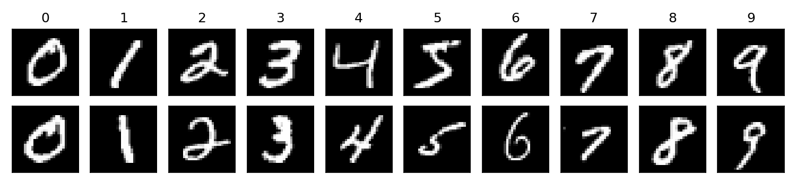

波士顿房价来自 Harrison 与 Rubinfeld（1978），共 506 个城镇样本、13 个输入特征和 1 个目标。目标 MEDV 是自住房屋价格中位数，单位是千美元，范围 5 到 50，其中 16 条被截断在 50。全体样本均值 22.53，标准差 9.19，中位数 21.2。

| 特征 | 含义 |
| --- | --- |
| CRIM | 城镇人均犯罪率 |
| ZN | 占地 25000 平方英尺以上的住宅用地比例 |
| INDUS | 非零售商业用地比例 |
| CHAS | 是否邻接 Charles River，0/1 |
| NOX | 一氧化氮浓度 |
| RM | 住宅平均房间数 |
| AGE | 1940 年以前建成的自住房比例 |
| DIS | 到五个就业中心的加权距离 |
| RAD | 径向公路可达性指数 |
| TAX | 每万美元的全额财产税率 |
| PTRATIO | 城镇师生比 |
| B | \(1000(B_k-0.63)^2\)，\(B_k\) 为城镇黑人人口比例 |
| LSTAT | 低收入人群占比 |
| MEDV | 房价中位数，千美元 |

## 3 数据预处理

MNIST：

- 像素经 `ToTensor` 转到 \([0,1]\)，再用均值 0.1307、标准差 0.3081 标准化，然后拉成 784 维。不做随机旋转或平移。
- 从训练集中按 9:1 划出验证集（54000 / 6000），测试集保持官方的 10000 张。划分用种子 42 的随机排列，与支持向量机实验相同。

波士顿房价：

- 先划出 20% 作为测试集，再从剩余样本中划出 20% 作为验证集，得到 323 / 81 / 102。种子同样是 42，与线性回归实验、支持向量机实验是同一次划分。
- `StandardScaler` 只在训练集上拟合，再作用到验证集和测试集。13 个特征的量纲差很大，TAX 的标准差约 168，CHAS 约 0.25。不标准化时，梯度会被大尺度特征主导。
- 目标保持原始的千美元单位，损失用均方误差。测试 RMSE 可以和前面的线性回归、支持向量回归比较。

## 4 算法介绍

一层全连接把上一层的向量 \(h\) 写成仿射变换。隐藏层后面接 ReLU，负的激活被截成 0：

\[
h^{(l)}=\mathrm{ReLU}\bigl(W^{(l)}h^{(l-1)}+b^{(l)}\bigr),\qquad
\mathrm{ReLU}(u)=\max(u,0).
\]

最后一层不加激活。分类时它输出 \(K=10\) 个 logits，回归时输出 1 个房价。图像在前向里被拉平，网络不使用像素的邻域关系。六个网络共用下面这个模块。`hidden_dims` 为空时只剩输入到输出的一层线性变换；否则每个隐藏层后接 ReLU，并可选用 Dropout 和批归一化。

```python
class MLP(nn.Module):
    def __init__(self, in_dim, hidden_dims, out_dim, dropout=0.0, batch_norm=False):
        super().__init__()
        layers = []
        prev = in_dim
        for width in hidden_dims:
            layers.append(nn.Linear(prev, width))
            if batch_norm:
                layers.append(nn.BatchNorm1d(width))
            layers.append(nn.ReLU(inplace=True))
            if dropout > 0:
                layers.append(nn.Dropout(dropout))
            prev = width
        layers.append(nn.Linear(prev, out_dim))
        self.net = nn.Sequential(*layers)

    def forward(self, x):
        if x.ndim > 2:
            x = x.reshape(x.size(0), -1)
        return self.net(x)
```

Dropout 在训练时把隐藏单元以概率 \(p\) 置成 0，预测时关闭。批归一化用当前 batch 的均值 \(\mu_B\) 和方差 \(\sigma_B^2\) 把激活拉回稳定范围，再乘可学习的缩放 \(\gamma\)、加上偏移 \(\beta\)：

\[
\mathrm{BN}(h)=\gamma\frac{h-\mu_B}{\sqrt{\sigma_B^2+\epsilon}}+\beta.
\]

优化器都是 AdamW，学习率 \(10^{-3}\)，权重衰减 \(10^{-4}\)。分类按验证集准确率保留权重，回归按验证集 RMSE 保留权重。测试集只在选完之后评估一次。

```python
CLASSIFIER_PRESETS = {
    "linear": {"hidden_dims": (), "dropout": 0.0, "batch_norm": False},
    "mlp_shallow": {"hidden_dims": (256,), "dropout": 0.2, "batch_norm": False},
    "mlp_deep": {"hidden_dims": (512, 256, 128), "dropout": 0.3, "batch_norm": True},
}

REGRESSOR_PRESETS = {
    "mlp_tiny": {"hidden_dims": (4,), "dropout": 0.0, "batch_norm": False},
    "mlp_small": {"hidden_dims": (64, 32), "dropout": 0.1, "batch_norm": False},
    "mlp_wide": {"hidden_dims": (128, 64, 32), "dropout": 0.2, "batch_norm": False},
}
```

**linear（MNIST 基线）**

结构是 \(784\to 10\)，没有隐藏层，也没有 ReLU 和 Dropout。参数量为

\[
784\times 10+10=7850.
\]

每一类只有一组权重，决策边界是 784 维像素空间里的超平面。它和后面两个网络用同一套交叉熵、同一套优化器和同一次划分。

**mlp_shallow（一个隐藏层）**

结构是 \(784\to 256\to 10\)，Dropout 概率 0.2，没有批归一化。参数量为

\[
784\times 256+256+256\times 10+10=203530.
\]

它在线性分类器上加一个 256 维的 ReLU 隐藏层，用来看这一层非线性把准确率抬高多少。

**mlp_deep（MNIST 主模型）**

结构是 \(784\to 512\to 256\to 128\to 10\)。每个隐藏层后接 BatchNorm、ReLU 和 Dropout（0.3）。可训练参数 569226，大约是浅层网络的 2.8 倍。批归一化用当前 batch 的均值和方差缩放该层激活。

分类的训练目标是交叉熵。设 logits 为 \(z\)，真实类别为 \(y\)，

\[
\ell(z,y)=-\log\frac{e^{z_y}}{\sum_{k=1}^{10}e^{z_k}}.
\]

预测取 \(\arg\max_k z_k\)。训练 8 个 epoch，batch size 128。学习率按余弦退火从 \(10^{-3}\) 降到 0：

\[
\eta_t=\frac12\eta\bigl(1+\cos(\pi t/T)\bigr),\qquad T=8.
\]

下面的循环在训练集上反传，在验证集上只前向。验证准确率更高时才覆盖已保存的权重。训练准确率在 Dropout 打开时统计，验证准确率在 Dropout 关闭时统计。

```python
def run_cls_epoch(model, loader, criterion, device, optimizer=None):
    training = optimizer is not None
    model.train(training)
    total_loss, correct, total = 0.0, 0, 0
    context = torch.enable_grad() if training else torch.no_grad()
    with context:
        for images, labels in loader:
            images = images.to(device)
            labels = labels.to(device)
            logits = model(images)
            loss = criterion(logits, labels)
            if training:
                optimizer.zero_grad(set_to_none=True)
                loss.backward()
                optimizer.step()
            total_loss += loss.item() * images.size(0)
            correct += (logits.argmax(dim=1) == labels).sum().item()
            total += images.size(0)
    return total_loss / total, correct / total


criterion = nn.CrossEntropyLoss()
optimizer = torch.optim.AdamW(model.parameters(), lr=1e-3, weight_decay=1e-4)
scheduler = torch.optim.lr_scheduler.CosineAnnealingLR(optimizer, T_max=8)
best_acc = -1.0
for epoch in range(1, 9):
    run_cls_epoch(model, train_loader, criterion, device, optimizer)
    _, val_acc = run_cls_epoch(model, val_loader, criterion, device)
    scheduler.step()
    if val_acc > best_acc:
        best_acc = val_acc
        torch.save({"model": model.state_dict()}, best_path)
```

**mlp_tiny（房价小模型）**

结构是 \(13\to 4\to 1\)，没有 Dropout。参数量为

\[
13\times 4+4+4\times 1+1=61.
\]

隐藏层是 4 个 ReLU 单元，对应的函数是分段线性的。它和后面两个网络用同一组标准化特征，学习率也是 \(10^{-3}\)。第 300 轮验证 RMSE 仍在下降，所以这一组的最大轮数放到 1000。早停规则不变：验证 RMSE 连续 40 轮没有下降就停止。

**mlp_small（房价主模型）**

结构是 \(13\to 64\to 32\to 1\)，Dropout 0.1。可训练参数 3009，大约是 4 个隐藏单元的 49 倍。训练样本 323 条，和 mlp_tiny 用同一次划分。

**mlp_wide（房价对照）**

结构是 \(13\to 128\to 64\to 32\to 1\)，Dropout 0.2。可训练参数 12161，大约是窄网络的 4 倍。它和窄网络看见同一组标准化特征，差别是宽度和 Dropout。

回归的最后一层输出标量 \(\hat y\)，损失是均方误差：

\[
\frac1n\sum_{i=1}^{n}(y_i-\hat y_i)^2.
\]

最多训练 300 个 epoch，batch size 32。验证 RMSE 连续 40 个 epoch 没有下降就停止，并恢复验证集上最好的权重。学习率在验证 RMSE 停滞约 13 个 epoch 后减半。记录曲线时再在训练集上做一次关闭 Dropout 的前向，否则训练损失会被随机置零抬高。

```python
def run_reg_epoch(model, loader, criterion, device, optimizer=None):
    training = optimizer is not None
    model.train(training)
    total_loss, total = 0.0, 0
    pred_parts, true_parts = [], []
    context = torch.enable_grad() if training else torch.no_grad()
    with context:
        for features, targets in loader:
            features = features.to(device)
            targets = targets.to(device)
            preds = model(features).squeeze(-1)
            loss = criterion(preds, targets)
            if training:
                optimizer.zero_grad(set_to_none=True)
                loss.backward()
                optimizer.step()
            total_loss += loss.item() * features.size(0)
            total += features.size(0)
            pred_parts.append(preds.detach().cpu().numpy())
            true_parts.append(targets.detach().cpu().numpy())
    return total_loss / total, np.concatenate(true_parts), np.concatenate(pred_parts)


criterion = nn.MSELoss()
optimizer = torch.optim.AdamW(model.parameters(), lr=1e-3, weight_decay=1e-4)
scheduler = torch.optim.lr_scheduler.ReduceLROnPlateau(
    optimizer, mode="min", factor=0.5, patience=13
)
best_rmse, stale = float("inf"), 0
for epoch in range(1, 301):
    run_reg_epoch(model, train_loader, criterion, device, optimizer)
    _, y_true_va, y_pred_va = run_reg_epoch(model, val_loader, criterion, device)
    val_rmse = float(np.sqrt(mean_squared_error(y_true_va, y_pred_va)))
    scheduler.step(val_rmse)
    if val_rmse < best_rmse - 1e-4:
        best_rmse, stale = val_rmse, 0
        torch.save({"model": model.state_dict()}, best_path)
    else:
        stale += 1
        if stale >= 40:
            break
```

同一划分上的普通最小二乘作为闭式解基线，最小化 \(\|y-Xw-b\|^2\)。特征已经标准化，系数可以比较线性贡献：RM 为 \(+3.63\)，LSTAT 为 \(-3.30\)，DIS 为 \(-3.22\)。房间数推高房价，低收入占比和到就业中心的距离压低房价。测试集上的 RMSE、MAE 和 \(R^2\) 按

\[
\mathrm{RMSE}=\sqrt{\frac1n\sum_{i=1}^{n}(y_i-\hat y_i)^2},\quad
\mathrm{MAE}=\frac1n\sum_{i=1}^{n}|y_i-\hat y_i|
\]

计算。\(R^2\) 用测试集真实值的方差做分母。

```python
def linear_baseline(x_train, y_train, x_test, y_test):
    model = LinearRegression()
    model.fit(x_train, y_train)
    pred = model.predict(x_test)
    rmse = float(np.sqrt(mean_squared_error(y_test, pred)))
    mae = float(mean_absolute_error(y_test, pred))
    r2 = float(r2_score(y_test, pred))
    return model, rmse, mae, r2
```

## 5 实验结果及分析

### 5.1 MNIST

#### 5.1.1 主实验

| 模型 | 参数量 | 最佳验证准确率 | 测试准确率 |
| --- | ---: | ---: | ---: |
| linear | 7,850 | 0.9167 | 0.9243 |
| mlp_shallow | 203,530 | 0.9810 | 0.9801 |
| mlp_deep | 569,226 | 0.9833 | 0.9858 |

linear 的验证准确率在第 8 个 epoch 最高，为 0.9167。测试集 10000 张上的准确率是 0.9243，分错 757 张。数字 1 的 f1 最高（0.9712），数字 8 最低（0.8811），数字 5 次低（0.8858）。最多的混淆是 2 分成 8，有 35 张；5 分成 3 有 33 张；7 分成 9、4 分成 9 各 31 张；9 分成 4 有 29 张。

下图左图是交叉熵，右图是准确率。横轴都是 epoch。蓝线是训练集，橙线是验证集。这个网络没有 Dropout。

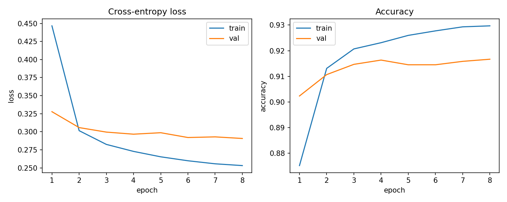

训练损失从 0.447 降到 0.253，验证损失从 0.328 降到 0.291，两条线后半段几乎走平。训练准确率从 0.875 升到 0.930，验证准确率从 0.902 升到 0.917。第 1 个 epoch 的训练准确率低于验证集，因为训练准确率是这一轮里权重还在更新时的平均；从第 2 个 epoch 起，训练准确率高于验证集，最后大约高 1.3 个百分点。验证准确率在第 5、6 个 epoch 停在 0.9145，第 8 个 epoch 回到 0.9167，测试用的是最后一个 epoch 的权重。

下一张是线性分类器在测试集上的混淆矩阵。行是真实数字，列是预测数字，颜色越深计数越大，对角线是分对的样本。


对角线仍然最深。2、5、8、9 这几行在对角线以外还有可见的计数，最深的是 2→8、5→3 和 4↔9。每一类只有一组线性权重，这几对数字各有三十张左右分错。

mlp_shallow 的最佳验证准确率出现在第 7 个 epoch，为 0.9810。测试集 10000 张上的准确率是 0.9801，比线性分类器高 5.58 个百分点。数字 1 的 f1 最高（0.9899），数字 9 最低（0.9715），数字 8 次低（0.9748）。最多的混淆是 9 分成 4，有 14 张；其次是 7 分成 2、4 分成 9，各 8 张；5 分成 3 有 7 张。线性分类器里 2→8 的 35 张，在这里是 6 张；5→3 的 33 张，在这里是 7 张。

下图左图是交叉熵，右图是准确率。横轴都是 epoch。蓝线是训练集，橙线是验证集。训练准确率在 Dropout 打开时统计。

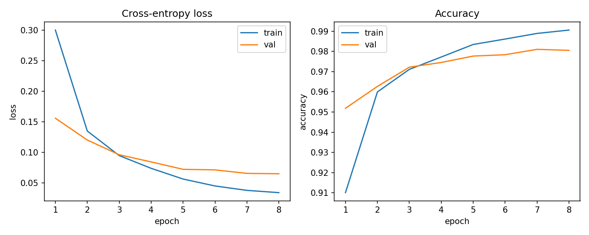

左图里两条损失都在前 3 个 epoch 快速下降，之后变平。训练损失从 0.300 降到 0.034，验证损失从 0.156 降到 0.065。第 3 个 epoch 起训练损失低于验证损失。右图里训练准确率从 0.910 升到 0.991，验证准确率从 0.952 升到第 7 个 epoch 的 0.981，第 8 个 epoch 为 0.9805。第 1 个 epoch 训练准确率低于验证集，因为 Dropout 还开着；第 4 个 epoch 起训练准确率超过验证集，两条线的间隔大约一个百分点。

下一张是浅层网络在测试集上的混淆矩阵。行是真实数字，列是预测数字，颜色越深计数越大，对角线是分对的样本。

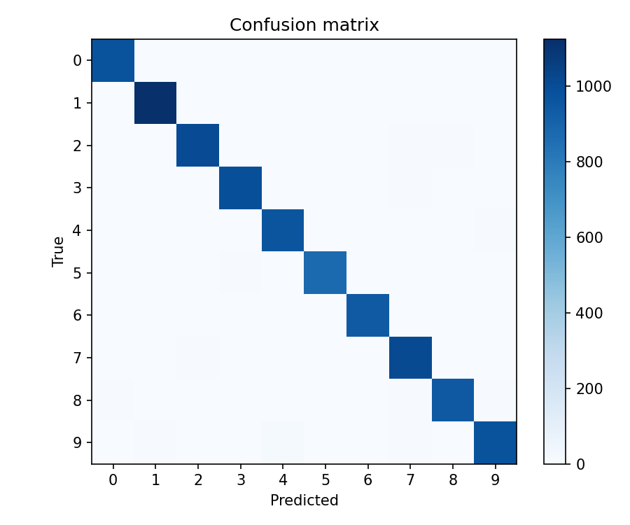

颜色集中在对角线上，1 的格子最深。对角线以外能看出的是 9 这一行在 4 上有一块浅色，以及 4 与 9、7 与 2 的零星计数。和线性 SVM 里几十张的 4↔9、2↔8 相比，这里最多的一格也只有 14 张。

mlp_deep 的验证准确率在第 8 个 epoch 达到 0.9833，测试准确率 0.9858，比浅层网络高 0.57 个百分点。各类 f1 都在 0.980 以上。数字 1 最高（0.9916），数字 7 最低（0.9806），数字 9 次低（0.9816）。9 分成 4 从 14 张降到 8 张，7 分成 2 仍是 8 张，4 分成 9 是 7 张，6 分成 4、3 分成 7 各 6 张。

下图的画法和浅层网络相同：左图交叉熵，右图准确率，蓝线训练，橙线验证。

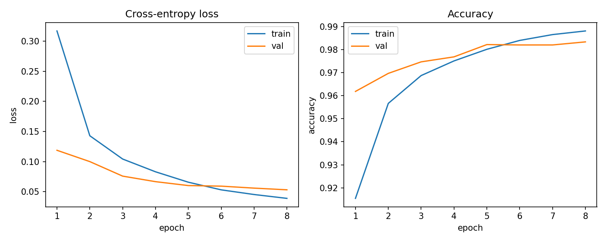

训练损失从 0.317 降到 0.039，验证损失从 0.119 降到 0.053。第 6 个 epoch 起训练损失低于验证损失，之后训练损失继续下降，验证损失几乎走平。右图里验证准确率在第 5 个 epoch 已经到 0.9822，后三个 epoch 只再增加到 0.9833。第 8 个 epoch 训练准确率 0.9881，验证准确率 0.9833，间隔大约半个百分点。

下一张是深层网络的测试集混淆矩阵，读法仍是行真实、列预测。


对角线比浅层网络更齐。非对角线最深的仍是 9→4 和 7→2，各 8 张。浅层网络里 9→4 的 14 张，在这里少了 6 张。4 和 9、7 和 2 仍然是剩下的主要混淆，只是每格都在 10 张以内。

各类 f1 如下。

| 数字 | linear | mlp_shallow | mlp_deep |
| ---: | ---: | ---: | ---: |
| 0 | 0.9644 | 0.9853 | 0.9898 |
| 1 | 0.9712 | 0.9899 | 0.9916 |
| 2 | 0.9140 | 0.9791 | 0.9865 |
| 3 | 0.9051 | 0.9793 | 0.9876 |
| 4 | 0.9304 | 0.9782 | 0.9822 |
| 5 | 0.8858 | 0.9798 | 0.9871 |
| 6 | 0.9451 | 0.9833 | 0.9864 |
| 7 | 0.9265 | 0.9787 | 0.9806 |
| 8 | 0.8811 | 0.9748 | 0.9841 |
| 9 | 0.9078 | 0.9715 | 0.9816 |

从线性分类器到一个隐藏层，十个数字的 f1 都上升。抬得最多的是 5（+0.0940）和 8（+0.0937），这两类在线性模型里最低；抬得最少的是 0（+0.0209）和 1（+0.0187），线性模型已经能分开它们。再从一层隐藏层加到三层，十个数字的 f1 继续上升，但幅度小得多：最多是 9（+0.0101）和 8（+0.0093），最少是 1（+0.0017）和 7（+0.0019）。

线性分类器用 7850 个参数达到测试准确率 0.9243。加上一个隐藏层之后是 0.9801，提高 5.58 个百分点。再加到三个隐藏层、56.9 万参数，测试准确率是 0.9858，再提高 0.57 个百分点。同一划分上，原始像素的线性 SVM 测试准确率是 0.9180，参数量也是 7850。80 个主成分上的 RBF SVM 是 0.9858，与深层感知机相同。

#### 5.1.2 训练过程

三个网络都训练满 8 个 epoch。下表是每个 epoch 的训练准确率和验证准确率。浅层和深层网络的训练准确率含 Dropout，线性分类器没有 Dropout。

| epoch | linear 训练 | linear 验证 | shallow 训练 | shallow 验证 | deep 训练 | deep 验证 |
| ---: | ---: | ---: | ---: | ---: | ---: | ---: |
| 1 | 0.8752 | 0.9023 | 0.9101 | 0.9518 | 0.9154 | 0.9618 |
| 2 | 0.9131 | 0.9107 | 0.9599 | 0.9627 | 0.9566 | 0.9697 |
| 3 | 0.9207 | 0.9147 | 0.9711 | 0.9722 | 0.9687 | 0.9747 |
| 4 | 0.9231 | 0.9163 | 0.9772 | 0.9745 | 0.9751 | 0.9768 |
| 5 | 0.9260 | 0.9145 | 0.9834 | 0.9777 | 0.9801 | 0.9822 |
| 6 | 0.9277 | 0.9145 | 0.9861 | 0.9783 | 0.9840 | 0.9820 |
| 7 | 0.9293 | 0.9158 | 0.9889 | 0.9810 | 0.9865 | 0.9820 |
| 8 | 0.9297 | 0.9167 | 0.9905 | 0.9805 | 0.9881 | 0.9833 |

线性分类器的验证准确率一路停在 0.91 附近，第 8 个 epoch 才到最高的 0.9167，测试用最后一个 epoch。浅层网络的验证准确率在第 7 个 epoch 最高。第 8 个 epoch 训练准确率继续升到 0.9905，验证准确率降到 0.9805，所以测试用的是第 7 个 epoch 的权重。深层网络的验证准确率在第 5 个 epoch 就到 0.9822，第 6、7 个 epoch 停在 0.9820，第 8 个 epoch 再升到 0.9833，测试用最后一个 epoch。

第 1 个 epoch 结束时，带隐藏层的两个网络验证准确率都已经高于 0.95，线性分类器只有 0.9023。浅层和深层网络前几个 epoch 的训练准确率低于验证集，是因为 Dropout 还开着。线性分类器没有 Dropout，第 2 个 epoch 起训练准确率就略高于验证集。8 个 epoch 的余弦退火已经把学习率降到接近 0。线性分类器的验证准确率还在缓慢上升，浅层网络已经开始回落。

从没有隐藏层到一个隐藏层，测试准确率从 0.9243 提到 0.9801，2→8 从 35 张降到 6 张，5→3 从 33 张降到 7 张。再加深并加上批归一化，测试准确率提到 0.9858，9→4 从 14 张降到 8 张。前一个差距是 5.58 个百分点，后一个是 0.57 个百分点。

### 5.2 波士顿房价

#### 5.2.1 主实验

| 模型 | 参数量 | 最佳验证 RMSE | 测试 RMSE | 测试 MAE | 测试 \(R^2\) |
| --- | ---: | ---: | ---: | ---: | ---: |
| 普通最小二乘 | 14 | — | 5.0102 | 3.2254 | 0.6577 |
| mlp_tiny | 61 | 4.4526 | 4.5198 | 2.9675 | 0.7214 |
| mlp_small | 3,009 | 3.8691 | 3.4443 | 2.1655 | 0.8382 |
| mlp_wide | 12,161 | 3.6833 | 3.4721 | 2.2485 | 0.8356 |

若始终预测全体均值，RMSE 大约就是目标标准差 9.19。最小二乘把它降到 5.0102，\(R^2\) 为 0.6577，与线性回归实验在同一划分上的数字一致。

mlp_tiny 在第 617 个 epoch 验证 RMSE 最低，为 4.4526，当时训练 RMSE 为 4.1155。验证集随后 40 个 epoch 没有再下降，在第 657 个 epoch 停止。该权重的测试 RMSE 是 4.5198，测试 MAE 是 2.9675，\(R^2\) 是 0.7214。比最小二乘低 0.49，比 64-32 的网络高 1.08。102 条测试样本里只有 84 条残差落在 \(\pm 5\) 以内。

下图左图是均方误差，右图是 RMSE，单位是千美元。蓝线是训练集，橙线是验证集。横轴画到实际停止的第 657 个 epoch。这个网络没有 Dropout。

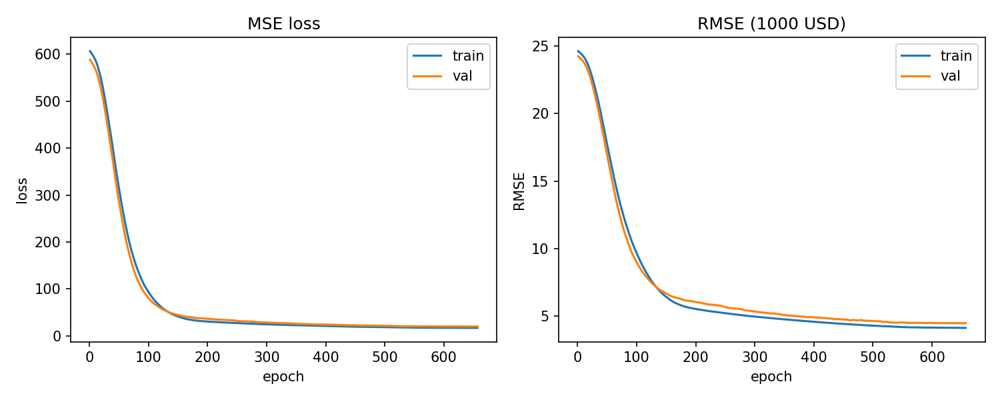

下降比后面两个网络慢。第 20 个 epoch 验证 RMSE 还有 22.886，第 100 个 epoch 是 8.972，第 300 个 epoch 是 5.315，这时接近最小二乘的测试误差 5.0102。最低点在第 617 个 epoch，训练 RMSE 4.116、验证 RMSE 4.453。学习率同为 \(10^{-3}\) 时，这一组的验证误差到六百多轮才停住。

下一张左图是测试集的预测对真实值，黑线是 \(y=x\)。右图是残差 \(\hat y-y\) 的直方图，0 处有一条竖线。

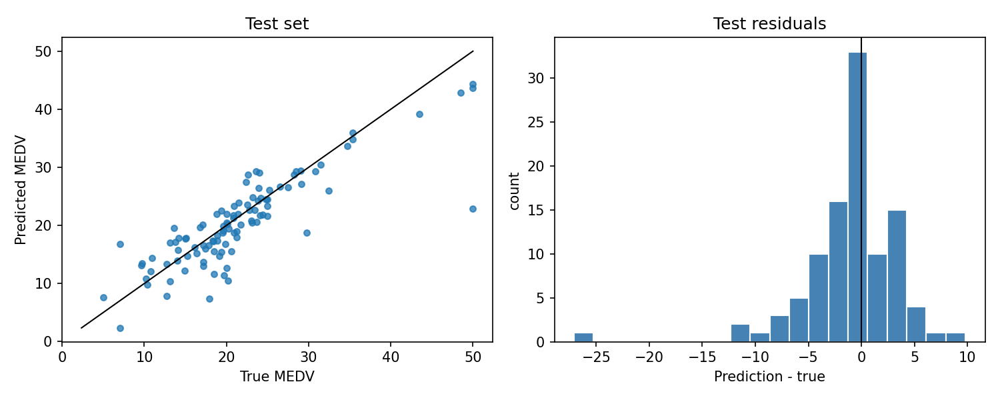

散点比后面两个网络更开，高价一端落在黑线下面。预测的最大值是 44.34。三个真实房价为 50 的样本被预测到 43.67、44.34 和 22.90，MAE 13.03，其中一条残差 \(-27.10\)。右图的主体比窄网络更宽，左尾伸到约 \(-27\)，右尾到 \(+9.81\)，对应真实房价 7.0、预测 16.81。预测最小值是 2.35。

mlp_small 在第 185 个 epoch 验证 RMSE 最低，为 3.8691，当时训练 RMSE 为 2.8130。验证集随后 40 个 epoch 没有再下降，在第 225 个 epoch 停止。该权重的测试 RMSE 是 3.4443，测试 MAE 是 2.1655，\(R^2\) 是 0.8382。MAE 约 2.17 个千美元，相对中位数 21.2 大约是一成。102 条测试样本里有 98 条残差落在 \(\pm 5\) 以内。

下图左图是均方误差，右图是 RMSE，单位是千美元。蓝线是关闭 Dropout 后的训练集，橙线是验证集。横轴画到实际停止的第 225 个 epoch。

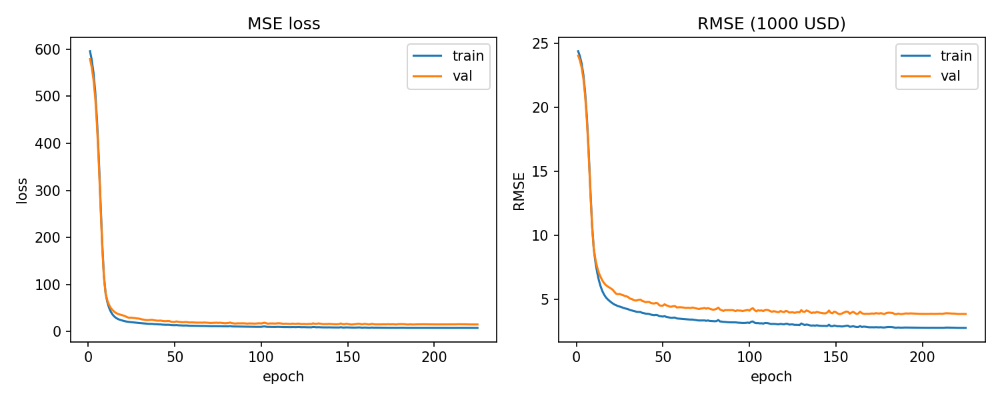

两条线在前 20 个 epoch 从 24 降到 6 附近，之后下降变慢。第 20 个 epoch 训练 RMSE 4.803、验证 RMSE 5.870；第 50 个 epoch 分别是 3.676 和 4.535；第 100 个 epoch 是 3.176 和 4.137。第 50 个 epoch 之后，验证曲线停在训练曲线上方大约 1 个 RMSE。最低的验证点在第 185 个 epoch，再往后验证 RMSE 回到 3.88 附近，早停把权重留在最低点。

下一张左图是测试集的预测对真实值，黑线是 \(y=x\)。右图是残差 \(\hat y-y\) 的直方图，0 处有一条竖线。

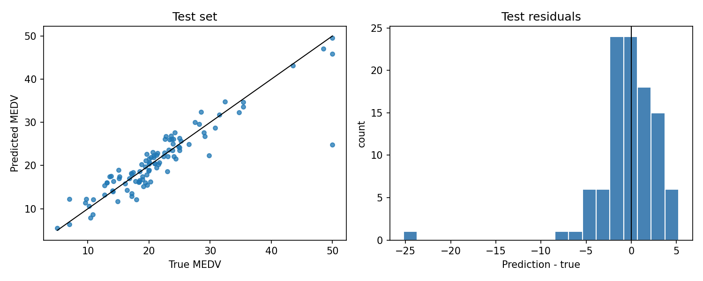

左图里 10 到 35 的点沿着黑线，离散程度大约正负几个千美元。真实房价为 50 的点有三个，预测分别是 45.87、49.51 和 24.78。前两个贴着黑线，第三个掉到 25 附近，残差 \(-25.22\)。这三个样本的 MAE 是 9.95。右图的主体在 \(-5\) 到 \(5\)，左边有一条孤立的尾巴，就是被预测到 24.78 的那条。预测的最小值是 5.53，没有落到 0 以下。真实房价 7.0 的样本被预测到 12.25，残差 \(+5.25\)。

mlp_wide 在第 129 个 epoch 达到验证 RMSE 3.6833，当时训练 RMSE 为 2.7823，在第 169 个 epoch 停止。测试 RMSE 3.4721，测试 MAE 2.2485，\(R^2\) 0.8356。验证 RMSE 比窄网络低 0.186，测试 RMSE 高 0.028。同样有 98 条测试残差落在 \(\pm 5\) 以内。

下图的坐标和窄网络相同，横轴停在第 169 个 epoch。

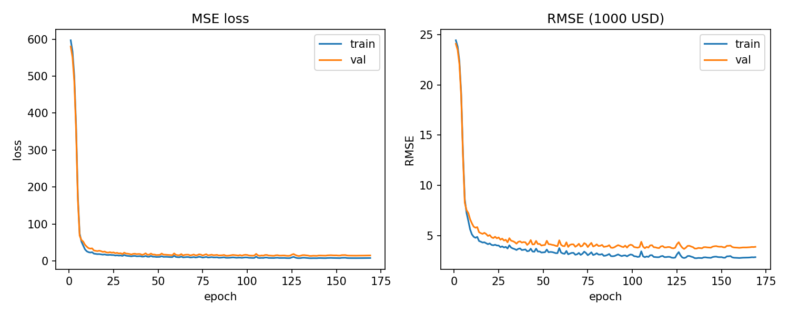

前 20 个 epoch 下降得比窄网络更快：第 20 个 epoch 验证 RMSE 已经是 5.062，窄网络此时是 5.870。第 50 个 epoch 验证 RMSE 4.061，第 100 个 epoch 4.049，中间这一段几乎走平，曲线的起伏也比窄网络大。最低点出现在第 129 个 epoch 的 3.683，到停止时验证 RMSE 回到 3.893。

预测图的画法与窄网络相同。

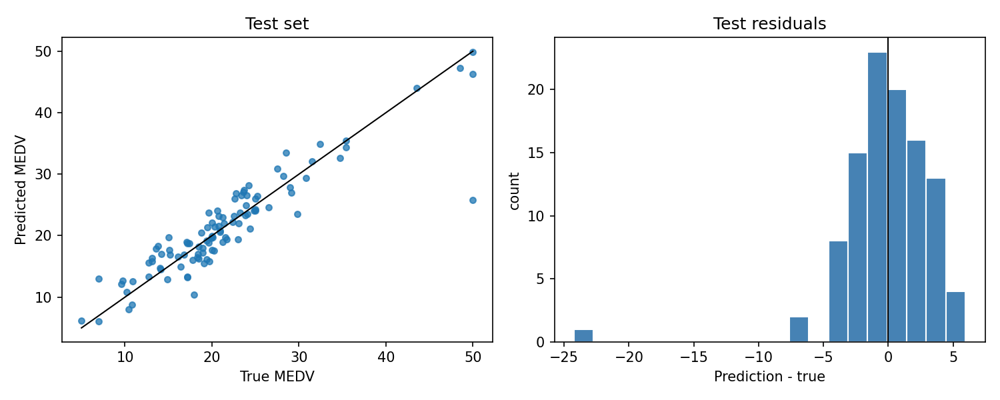

中等价位的点仍沿着黑线。三个真实房价为 50 的样本被预测到 46.24、49.81 和 25.77，MAE 9.39，其中一条残差约 \(-24.23\)。右图同样是中间一座峰，左边一条孤立的尾巴。预测最小值是 6.03。真实房价 7.0 的样本被预测到 12.95，残差 \(+5.95\)。

最小二乘的测试 RMSE 是 5.01。4 个隐藏单元把它降到 4.52，\(R^2\) 从 0.66 提到 0.72；64-32 的网络再降到 3.44，\(R^2\) 提到 0.84。同一划分上，线性 SVR 的测试 RMSE 是 5.12，RBF SVR 是 4.09。4 个隐藏单元仍高于 RBF SVR，64-32 和更宽的网络低于 RBF SVR。感知机最小化平方误差，并在验证集变差时停住；RBF SVR 选中的 \(C=1000\) 让绝大多数训练点变成支持向量，测试 RMSE 停在 4.09。线性 SVR 会把房价预测成负数。这三个网络的预测最小值分别是 2.35、5.53 和 6.03。房价被截断在 50 的三个测试样本里，每个网络都有一条被预测到 22.9 到 25.8。

#### 5.2.2 宽度与早停

下表是若干 epoch 上的训练 RMSE 和验证 RMSE。训练指标在 Dropout 关闭后计算。

| epoch | tiny 训练 | tiny 验证 | small 训练 | small 验证 | wide 训练 | wide 验证 |
| ---: | ---: | ---: | ---: | ---: | ---: | ---: |
| 1 | 24.6313 | 24.2592 | 24.4105 | 24.0671 | 24.4312 | 24.0843 |
| 20 | 23.3598 | 22.8856 | 4.8033 | 5.8698 | 4.2326 | 5.0616 |
| 50 | 17.7408 | 16.9206 | 3.6760 | 4.5352 | 3.3441 | 4.0608 |
| 100 | 9.6547 | 8.9724 | 3.1764 | 4.1373 | 3.0961 | 4.0488 |
| 最佳 | 4.1155 | 4.4526 | 2.8130 | 3.8691 | 2.7823 | 3.6833 |
| 停止 | 4.1045 | 4.4541 | 2.7947 | 3.8821 | 2.8659 | 3.8930 |

4 个隐藏单元的最佳 epoch 是 617，窄网络是 185，宽网络是 129。第 20 个 epoch 时，窄网络和宽网络的验证 RMSE 已经到 5.9 和 5.1，4 个隐藏单元还有 22.9。同样的学习率下，隐藏单元越少，误差降得越慢。最佳点上，窄网络和宽网络的训练 RMSE 都在 2.8 附近，验证 RMSE 比训练高大约 1；4 个隐藏单元的训练 RMSE 是 4.116，验证 RMSE 是 4.453，训练集本身就没拟合到那两个网络的程度。停止时窄网络的训练 RMSE 还在下降（2.795），验证 RMSE 已经回到 3.882；宽网络的训练 RMSE 从 2.782 回到 2.866，验证 RMSE 回到 3.893。早停丢掉的是最佳点之后的权重。

宽网络参数量是窄网络的 4 倍，Dropout 也从 0.1 加到 0.2。它更早到达较低的验证 RMSE，验证集上的最低点也更低。这 0.186 的验证差距没有变成测试集上的优势：测试 RMSE 3.472，比窄网络的 3.444 高 0.028，测试 MAE 2.248 比 2.166 高 0.083。验证集只有 81 条，这个差距落在抽样波动里。

从 61 个参数加到 3009 个参数，测试 RMSE 从 4.52 降到 3.44。再加到 12161 个参数后，训练曲线下降更快，验证集的最低点更低，测试 RMSE 是 3.47。早停保留的是验证 RMSE 最低的那一轮，不是最后一轮。若用最后一个 epoch 的权重，4 个隐藏单元的验证 RMSE 从 4.453 变到 4.454，窄网络从 3.869 回到 3.882，宽网络从 3.683 回到 3.893。

## 6 总结

MNIST 上，mlp_shallow 和 mlp_deep 都好于线性 softmax，mlp_deep 略好于 mlp_shallow。线性模型给每一类一组权重，边界是超平面，2 和 8、5 和 3 这类笔画相近的写法分不开。加上一个 ReLU 隐藏层之后，像素被组合成非线性特征，这类混淆少了。再加到三层并换上 BatchNorm，8 和 9 只再分开一点，4 和 9、7 和 2 仍然容易混。层数、BatchNorm 和 Dropout 是一起换的，看不出多出来的差别来自哪一项。

房价上，mlp_small 好于最小二乘，也好于 mlp_tiny 和 mlp_wide。最小二乘把房间数、低收入占比和就业距离按固定系数相加，表示不了非线性关系。两层 ReLU 可以组合这些因素，误差低于最小二乘，也低于同一划分上用 \(\varepsilon\)-不敏感损失的 RBF SVR。mlp_tiny 只有 4 个隐藏单元，分段少，训练集没有拟合上，高价样本预测偏低。mlp_wide 的验证误差更低，训练集没有拟合得更紧，多出来的宽度在几百条样本上没有降低测试误差。宽网络后半段验证误差会回升，所以要留验证误差最低的那一轮。三个网络都把顶在房价上限的样本预测低，加宽之后仍然如此。

```bash
python3 train.py --task mnist --model linear --epochs 8
python3 train.py --task mnist --model mlp_shallow --epochs 8
python3 train.py --task mnist --model mlp_deep --epochs 8
python3 train.py --task boston --model mlp_tiny --epochs 1000
python3 train.py --task boston --model mlp_small
python3 train.py --task boston --model mlp_wide
```

## 复现环境

Python 3.10.10，NumPy 2.2.6，PyTorch 2.14.1，torchvision 0.29.1，scikit-learn 1.7.2。依赖见 `requirements.txt`。MNIST 由 torchvision 读取，放在 `data/MNIST`，没有则自动下载。波士顿房价表在 `data/boston_house_prices.csv`，缺失时从 StatLib 的原始文件解析。
