# 课程报告：支持向量机分类与回归

## 1 任务描述

1. 基于 MNIST 数据集，设计并实现线性 SVM 和非线性 SVM 分类器。非线性模型用 RBF 核。同一组主成分上另外训练一个线性 SVM，用来把降维和核函数分开。
2. 用支持向量回归预测波士顿房价。数据与 Kaggle 上的 Boston House Prices、以及旧版 scikit-learn 的 `load_boston` 相同。当前环境的 scikit-learn 1.7 已移除该接口，因此直接读取原始的 506 条样本。回归部分包含线性核 SVR 和 RBF 核 SVR，并在同一划分上拟合普通最小二乘作为对照。

## 2 数据描述

MNIST 是手写数字数据集，共 10 类（0–9）。训练集 60000 张，测试集 10000 张，图像为 $28\times 28$ 灰度图，像素取值 0–255。笔画是深色，背景接近 0。数据由 torchvision 读取。

下图是训练集里每个数字的前两张。同一类的写法并不固定：1 有的几乎竖直，有的向一侧倾斜；4 有的封闭、有的开口；7 的横笔可长可短；9 的圈有的留口、有的封死。线性 SVM 对每一类只学一组权重，这些写法进同一组权重。RBF 按训练样本之间的相似度区分它们。

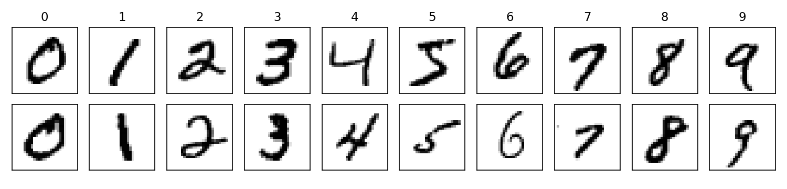

波士顿房价来自 Harrison 与 Rubinfeld（1978），共 506 个城镇样本、13 个输入特征和 1 个目标。目标 MEDV 是自住房屋价格中位数，单位是千美元，范围 5 到 50，其中 16 条被截断在 50。全体样本均值 22.53，标准差 9.19，中位数 21.2。

| 特征 | 含义 |
| --- | --- |
| CRIM | 城镇人均犯罪率 |
| ZN | 占地 25000 平方英尺以上的住宅用地比例 |
| INDUS | 非零售商业用地比例 |
| CHAS | 是否邻接 Charles River，0/1 |
| NOX | 一氧化氮浓度 |
| RM | 住宅平均房间数 |
| AGE | 1940 年以前建成的自住房比例 |
| DIS | 到五个就业中心的加权距离 |
| RAD | 径向公路可达性指数 |
| TAX | 每万美元的全额财产税率 |
| PTRATIO | 城镇师生比 |
| B | $1000(B_k-0.63)^2$，$B_k$ 为城镇黑人人口比例 |
| LSTAT | 低收入人群占比 |
| MEDV | 房价中位数，千美元 |

## 3 数据预处理

MNIST：

- 像素除以 255，得到 $x/255\in[0,1]$，再拉成 784 维。训练集里有 69 个像素在全部样本上为 0，另有 278 个像素的标准差低于 0.05，都集中在图像边缘。这些近乎常数的维度一旦做标准化，会被放大成噪声，因此这里不做 `StandardScaler`。
- 从训练集中按 9:1 划出验证集（54000 / 6000），测试集保持官方的 10000 张。划分用种子 42 的随机排列，与多层感知机实验相同。
- RBF 核在 $54000\times 784$ 上直接算距离很贵，像素之间又有大量冗余。主成分分析只在训练集上拟合，取前 40、80、120 个成分做搜索。前 44 个成分解释 80% 的方差，前 87 个解释 90%，前 154 个解释 95%。40、80、120 个成分实际解释的方差是 78.63%、89.06%、93.12%。PCA 会按训练集中心化，验证集和测试集只用这个中心和这组基。

波士顿房价：

- 先划出 20% 作为测试集，再从剩余样本中划出 20% 作为验证集，得到 323 / 81 / 102。种子同样是 42，与线性回归实验、多层感知机实验是同一次划分。
- `StandardScaler` 只在训练集上拟合，再作用到验证集和测试集。13 个特征的量纲差很大，不标准化的话，核函数的距离会被 TAX 这类大尺度特征主导。
- 目标保持原始的千美元单位。SVR 的 $\varepsilon$ 管直接对应房价误差，测试 RMSE 也可以和前面的线性回归、多层感知机比较。

## 4 算法介绍

软间隔 SVM 在最大间隔和训练误差之间用 $C$ 做折中：

$$
\min_{w,b,\xi}\ \frac12\|w\|^2+C\sum_{i=1}^{n}\xi_i
\quad\text{s.t.}\quad
y_i(w^\top x_i+b)\ge 1-\xi_i,\quad \xi_i\ge 0.
$$

$C$ 越大，间隔越窄，训练集上的违反被罚得越重。多类分类有两种做法：线性模型用 one-vs-rest，10 个二分类器；RBF 模型用 libsvm 的 one-vs-one，$10\times 9/2=45$ 个二分类器，预测时投票。五个模型的训练代码都在 `train.py`。分类按验证集准确率选超参，回归按验证集 RMSE 选超参；并列时取更小的 $C$。测试集只在选完之后评估一次。

网格和选择规则如下。`cls_key` 让验证准确率高的组合排在前面，准确率相同时依次偏好更小的 $C$、更少的主成分和更小的 $\gamma$。`reg_key` 让验证 RMSE 低的组合排在前面，RMSE 相同时依次偏好更小的 $C$、更小的 $\gamma$ 和更宽的 $\varepsilon$。`gamma_scale` 与 sklearn 的 `gamma="scale"` 相同：

$$
\gamma_{\mathrm{scale}}=\frac{1}{d\cdot\mathrm{Var}(X)}.
$$

方差为 0 时退回 1。这里 $d$ 是特征数，$\mathrm{Var}(X)$ 是全体元素的方差。

```python
LINEAR_C_GRID = (0.001, 0.01, 0.1, 1.0, 10.0)
PCA_DIMS = (40, 80, 120)
RBF_C_GRID = (0.1, 1.0, 10.0, 100.0)
RBF_GAMMA_MULT = (0.1, 1.0, 3.0)
SVR_C_GRID = (0.1, 1.0, 10.0, 100.0, 1000.0, 10000.0)
SVR_EPSILON_GRID = (0.1, 0.5, 1.0, 2.0, 4.0, 8.0)
SVR_GAMMA_MULT = (0.1, 0.3, 1.0, 3.0, 10.0)

def cls_key(trial):
    return (trial["val_acc"], -trial["C"], -trial.get("pca_dim", 0), -trial.get("gamma", 0.0))

def reg_key(trial):
    return (-trial["val_rmse"], -trial["C"], -trial.get("gamma", 0.0), trial["epsilon"])

def gamma_scale(features):
    variance = float(features.var())
    if variance == 0:
        return 1.0
    return 1.0 / (features.shape[1] * variance)
```

**linear（MNIST 线性 SVM）**

`LinearSVC` 的损失是平方合页损失，写在参数 `loss="squared_hinge"` 里：

$$
V(y,f(x))=\max\bigl(0,\ 1-yf(x)\bigr)^2.
$$

训练集有 54000 条、特征只有 784 维，样本数大于特征数，因此 `dual=False`，解的是原始问题。平方合页损失对大的间隔违反罚得更重。模型给出 10 组权重和截距，共 7850 个参数，每个类别的权重可以画回 $28\times 28$，看成该类相对其余类的模板。循环结束前只比较验证集；测试准确率用的是验证集选中的那一组权重。

```python
def run_linear(data, seed):
    best_clf, best = None, None
    for c_value in LINEAR_C_GRID:
        clf = LinearSVC(
            C=c_value,
            loss="squared_hinge",
            dual=False,
            max_iter=5000,
            tol=1e-4,
            random_state=seed,
        )
        clf.fit(data["x_train"], data["y_train"])
        train_acc = (clf.predict(data["x_train"]) == data["y_train"]).mean()
        val_acc = (clf.predict(data["x_val"]) == data["y_val"]).mean()
        trial = {"C": c_value, "train_acc": train_acc, "val_acc": val_acc}
        if best is None or cls_key(trial) > cls_key(best):
            best, best_clf = trial, clf
    test_acc = (best_clf.predict(data["x_test"]) == data["y_test"]).mean()
    return best_clf, best, test_acc
```

**linear_pca（同一主成分上的线性对照）**

结构和 linear 相同，输入换成前 40、80 或 120 个主成分。主成分只在训练集上拟合。它和下面的 RBF 模型看见的是同一组特征，差别只在决策边界是不是超平面。

```python
def run_linear_pca(data, seed):
    pca = PCA(n_components=200, svd_solver="full", random_state=seed)
    z_train = pca.fit_transform(data["x_train"])
    z_val = pca.transform(data["x_val"])
    z_test = pca.transform(data["x_test"])

    best_clf, best = None, None
    for dim in PCA_DIMS:
        x_train = np.ascontiguousarray(z_train[:, :dim])
        x_val = np.ascontiguousarray(z_val[:, :dim])
        for c_value in LINEAR_C_GRID:
            clf = LinearSVC(
                C=c_value,
                loss="squared_hinge",
                dual=False,
                max_iter=5000,
                tol=1e-4,
                random_state=seed,
            )
            clf.fit(x_train, data["y_train"])
            val_acc = (clf.predict(x_val) == data["y_val"]).mean()
            trial = {"pca_dim": dim, "C": c_value, "val_acc": float(val_acc)}
            if best is None or cls_key(trial) > cls_key(best):
                best, best_clf = trial, clf
    dim = best["pca_dim"]
    x_test = np.ascontiguousarray(z_test[:, :dim])
    test_acc = (best_clf.predict(x_test) == data["y_test"]).mean()
    return best_clf, best, test_acc
```

**rbf（MNIST 非线性 SVM）**

`SVC` 的核函数是

$$
K(x,x')=\exp\bigl(-\gamma\|x-x'\|^2\bigr).
$$

$\gamma$ 以 sklearn 的 `scale` 为基准，即 $\gamma_{\mathrm{scale}}=1/(d\cdot\mathrm{Var}(X))$，再乘 0.1、1、3。10 倍的 $\gamma$ 会把核收得过尖，几乎每个训练点都变成支持向量，验证准确率掉到 0.4 附近，因此没有放进网格。$C$ 取 0.1、1、10、100。决策函数只在支持向量上非零：

$$
f(x)=\sum_{i\in\mathcal{S}}\alpha_i y_i K(x_i,x)+b,
$$

其中 $\mathcal{S}$ 是支持向量集合。libsvm 对 10 类做一对一，共 45 个二分类器，预测时投票。

```python
def run_rbf(data, seed):
    pca = PCA(n_components=200, svd_solver="full", random_state=seed)
    z_train = pca.fit_transform(data["x_train"])
    z_val = pca.transform(data["x_val"])
    z_test = pca.transform(data["x_test"])

    best_clf, best = None, None
    for dim in PCA_DIMS:
        x_train = np.ascontiguousarray(z_train[:, :dim])
        x_val = np.ascontiguousarray(z_val[:, :dim])
        base_gamma = gamma_scale(x_train)
        for c_value in RBF_C_GRID:
            for mult in RBF_GAMMA_MULT:
                gamma = base_gamma * mult
                clf = SVC(C=c_value, kernel="rbf", gamma=gamma, cache_size=1024)
                clf.fit(x_train, data["y_train"])
                val_acc = (clf.predict(x_val) == data["y_val"]).mean()
                trial = {
                    "pca_dim": dim,
                    "C": c_value,
                    "gamma": gamma,
                    "gamma_mult": mult,
                    "val_acc": float(val_acc),
                    "n_support": int(np.sum(clf.n_support_)),
                }
                if best is None or cls_key(trial) > cls_key(best):
                    best, best_clf = trial, clf
    dim = best["pca_dim"]
    x_test = np.ascontiguousarray(z_test[:, :dim])
    test_acc = (best_clf.predict(x_test) == data["y_test"]).mean()
    return best_clf, best, test_acc
```

**linear_svr（房价线性 SVR）**

`SVR(kernel="linear")`。$\varepsilon$-不敏感损失为

$$
L_\varepsilon(y,f(x))=\max\bigl(0,\ |y-f(x)|-\varepsilon\bigr),
$$

残差绝对值不超过 $\varepsilon$ 时损失为 0。$\varepsilon$ 的单位是千美元。样本只有 323 条，直接用线性核。落在 $\varepsilon$ 管外的训练点才成为支持向量。

```python
def run_linear_svr(data):
    best_clf, best = None, None
    for c_value in SVR_C_GRID:
        for epsilon in SVR_EPSILON_GRID:
            clf = SVR(kernel="linear", C=c_value, epsilon=epsilon, cache_size=512)
            clf.fit(data["x_train"], data["y_train"])
            val_pred = clf.predict(data["x_val"])
            val_rmse = float(np.sqrt(mean_squared_error(data["y_val"], val_pred)))
            trial = {
                "C": c_value,
                "epsilon": epsilon,
                "val_rmse": val_rmse,
                "n_support": int(clf.support_.size),
            }
            if best is None or reg_key(trial) > reg_key(best):
                best, best_clf = trial, clf
    test_pred = best_clf.predict(data["x_test"])
    return best_clf, best, test_pred
```

**rbf_svr（房价非线性 SVR）**

同一套 $C$ 和 $\varepsilon$，核换成 RBF。标准化之后各特征方差约为 1，13 维特征上 `scale` 对应

$$
\gamma=\frac{1}{13}\approx 0.0769,
$$

网格再乘 0.1、0.3、1、3、10。

```python
def run_rbf_svr(data):
    base_gamma = gamma_scale(data["x_train"])
    best_clf, best = None, None
    for c_value in SVR_C_GRID:
        for epsilon in SVR_EPSILON_GRID:
            for mult in SVR_GAMMA_MULT:
                gamma = base_gamma * mult
                clf = SVR(
                    kernel="rbf",
                    C=c_value,
                    epsilon=epsilon,
                    gamma=gamma,
                    cache_size=512,
                )
                clf.fit(data["x_train"], data["y_train"])
                val_pred = clf.predict(data["x_val"])
                val_rmse = float(np.sqrt(mean_squared_error(data["y_val"], val_pred)))
                trial = {
                    "C": c_value,
                    "epsilon": epsilon,
                    "gamma": gamma,
                    "gamma_mult": mult,
                    "val_rmse": val_rmse,
                    "n_support": int(clf.support_.size),
                }
                if best is None or reg_key(trial) > reg_key(best):
                    best, best_clf = trial, clf
    test_pred = best_clf.predict(data["x_test"])
    return best_clf, best, test_pred
```

同一划分上的普通最小二乘作为闭式解基线，最小化

$$
\|y-Xw-b\|^2.
$$

它的测试 RMSE 与线性回归实验一致，用来核对是不是同一次划分。RMSE 与 MAE、$R^2$ 按测试集上的预测计算：

$$
\mathrm{RMSE}=\sqrt{\frac1n\sum_{i=1}^{n}(y_i-\hat y_i)^2},\quad
\mathrm{MAE}=\frac1n\sum_{i=1}^{n}|y_i-\hat y_i|.
$$

```python
def linear_baseline(data):
    model = LinearRegression()
    model.fit(data["x_train"], data["y_train"])
    pred = model.predict(data["x_test"])
    rmse = float(np.sqrt(mean_squared_error(data["y_test"], pred)))
    return model, rmse
```

## 5 实验结果及分析

### 5.1 MNIST

#### 5.1.1 主实验

| 模型 | 规模 | 最佳验证准确率 | 测试准确率 |
| --- | ---: | ---: | ---: |
| linear | 7,850 个参数 | 0.9060 | 0.9180 |
| rbf | 9,907 个支持向量 | 0.9878 | 0.9858 |

linear 选中 $C=0.1$，训练准确率 0.9256，验证准确率 0.9060。这一组在 15 次迭代内收敛。测试集 10000 张上的准确率是 0.9180。数字 1 的 f1 最高（0.9674），数字 8 最低（0.8669），数字 5 次低（0.8741）。最常见的混淆是 4 分成 9、2 分成 8，各 37 张，5 分成 3 有 36 张。

下图是 10 个 one-vs-rest 分类器的权重，各自画回 $28\times 28$。红色是该类的正权重，蓝色是负权重，每张图按自身最大绝对值上色。

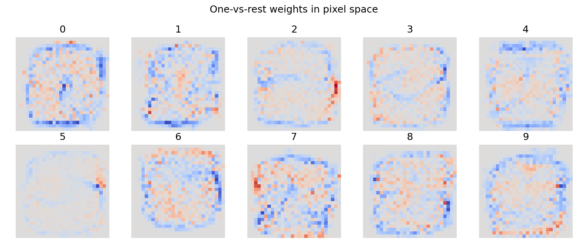

0 的正权重围成一圈，1 是中间一竖，7 带一横。这是每一类在像素上的平均模板。4 和 9、2 和 8 的模板重叠较多，和上面的混淆一致。

下一张是测试集混淆矩阵。行是真实数字，列是预测数字，颜色越深计数越大，对角线是分对的样本。


对角线最深的是 0 和 1。对角线以外最深的是 4→9、2→8，其次是 5→3。数字 8 的一行散得比较开，对应它最低的 f1。

rbf 选中 80 个主成分、$C=100$、$\gamma$ 等于 `scale`（0.0213）。验证准确率 0.9878，测试准确率 0.9858，训练准确率 1.0000。支持向量 9907 个，占 54000 张训练集的 18.3%。数字 1 的支持向量最少（405），数字 8 最多（1377）。数字 8 在线性模型里 f1 也最低，这些点落在间隔附近。各类 f1 都在 0.979 以上，数字 9 最低（0.9791），数字 1 最高（0.9938）。最多的混淆是 7 分成 2，只有 9 张。

下图和线性 SVM 的混淆矩阵类似：行是真实类别，列是预测类别。

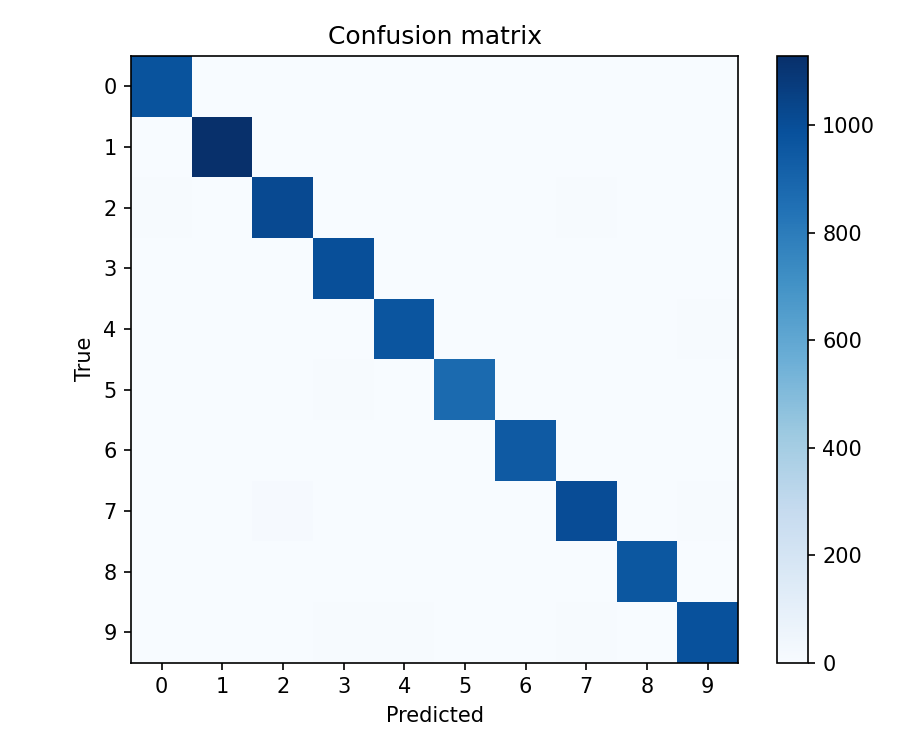

颜色几乎都集中在对角线上。非对角线最深的一格是 7→2，9 张；4→9 有 8 张。线性模型里那几组成十张的混淆，在这里都压到了个位数。

线性 SVM 能认出大部分数字，但 4 和 9、2 和 8 仍容易认错。每一类只有一组权重，不同写法都用这组权重判断。RBF 把写法不同的同类样本留在间隔附近，这几对数字的混淆少很多，分类结果好于线性 SVM。

#### 5.1.2 消融实验：主成分与核函数

linear_pca 和 rbf 用同一组主成分，差别是决策边界是不是超平面。这里看两件事：RBF 比线性模型高，是不是因为先做了降维；去掉后面的主成分，线性 SVM 的准确率会不会下降。

| 输入 | 模型 | 最佳验证准确率 | 测试准确率 |
| --- | --- | ---: | ---: |
| 原始 784 维像素 | linear，$C=0.1$ | 0.9060 | 0.9180 |
| 120 个主成分 | linear_pca，$C=0.1$ | 0.9025 | 0.9144 |
| 80 个主成分 | linear_pca，$C=1$ | 0.8945 | 0.9094 |
| 80 个主成分 | rbf，$C=100$，$\gamma=\gamma_{\mathrm{scale}}$ | 0.9878 | 0.9858 |

linear_pca 在 120 个主成分、$C=0.1$ 上验证准确率最高，为 0.9025，测试准确率 0.9144。40 个主成分时验证准确率最高只有 0.8758，80 个时最高 0.8945。主成分留得越多，线性模型越好，但 120 个成分已经解释 93.12% 的方差，测试准确率仍比原始像素上的线性 SVM 低 0.36 个百分点。丢掉的那部分方差里还有线性边界用得上的信息。

前 44 个成分解释 80% 的方差，前 87 个解释 90%，前 154 个解释 95%。40、80、120 个成分实际解释 78.63%、89.06%、93.12%。

下图的横轴是主成分个数，纵轴是训练集上的累积解释方差。三条灰线从下到上是 0.80、0.90、0.95。曲线只画到拟合时保留的 200 个成分。

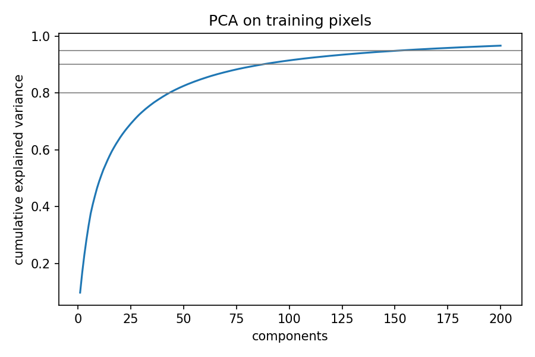

前 50 个成分上升很快，之后变平。40 个成分还在 0.80 那条线下面，80 个贴近 0.90，120 个落在 0.90 和 0.95 之间。到 200 个成分时曲线仍没有碰到 1，后面的成分每个只贡献很少的方差。

在 RBF 选中的那 80 个主成分上，线性 SVM 的 $C=1$ 与 $C=10$ 验证准确率同为 0.8945，按更小的 $C$ 取 $C=1$。这组的测试准确率是 0.9094。同一输入上 RBF 的测试准确率是 0.9858，高 7.64 个百分点。这组差距来自核函数。

下图是验证集选中的 linear_pca 在测试集上的混淆矩阵，对应 120 个主成分、$C=0.1$，不是上面 80 维那一行。读法仍是行真实、列预测。

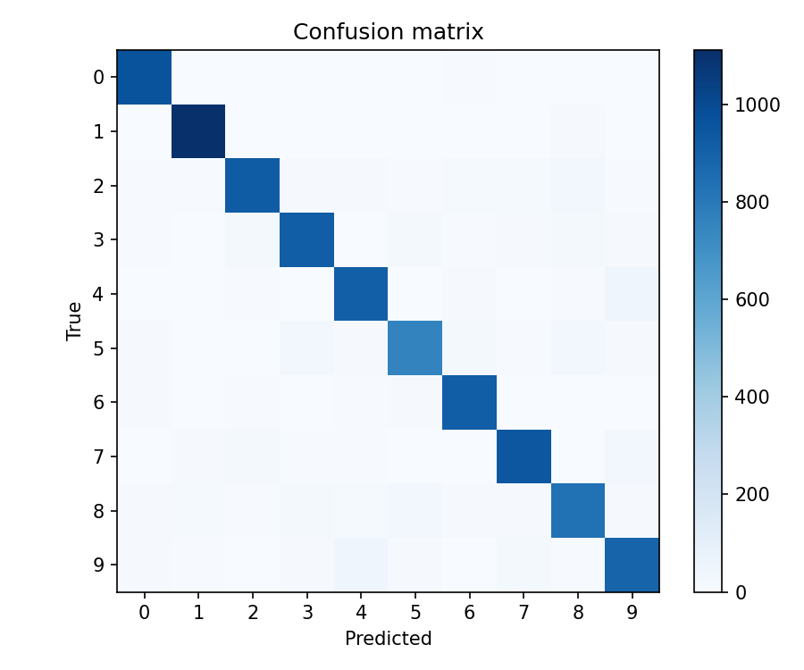

错误类型和原始像素上的线性 SVM 相同。9→4 有 45 张，4→9 有 44 张；8→5、7→9、5→3 各 34 张。换成主成分之后，4 和 9 仍然是主要的混淆。

先做主成分再训练线性 SVM，准确率没有高于直接用像素，4 和 9 仍然容易混。同一组主成分上，线性 SVM 仍明显低于 RBF。RBF 更高，是因为核函数给出非线性边界；把图像压到几十维并没有让线性模型变好。

#### 5.1.3 超参分析

线性 SVM 的 $C$ 从 0.01 到 10，验证准确率只在 0.905 附近挪动：$C=0.01$ 为 0.9058，$C=0.1$ 为 0.9060，$C=1$ 为 0.9052，$C=10$ 为 0.9048。训练准确率则从 0.9200 升到 0.9289。验证集选中的是 $C=0.1$。

下图横轴是 $C$，用对数刻度；纵轴是准确率。蓝线是训练集，橙线是验证集。五个点对应 $C=0.001,0.01,0.1,1,10$。

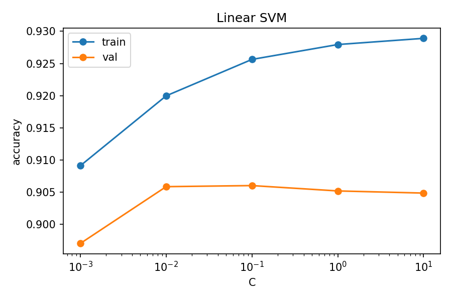

蓝线从 0.909 升到 0.929，$C$ 越大训练集贴得越紧。橙线在 $C=0.001$ 时只有 0.897，到 $C=0.01$ 升到 0.906，之后略往下走。两条线之间始终有大约两个百分点，验证集的最高点就是选中的 $C=0.1$。

下一张只画验证准确率。蓝、橙、绿分别是 40、80、120 个主成分，横轴仍是对数刻度的 $C$。

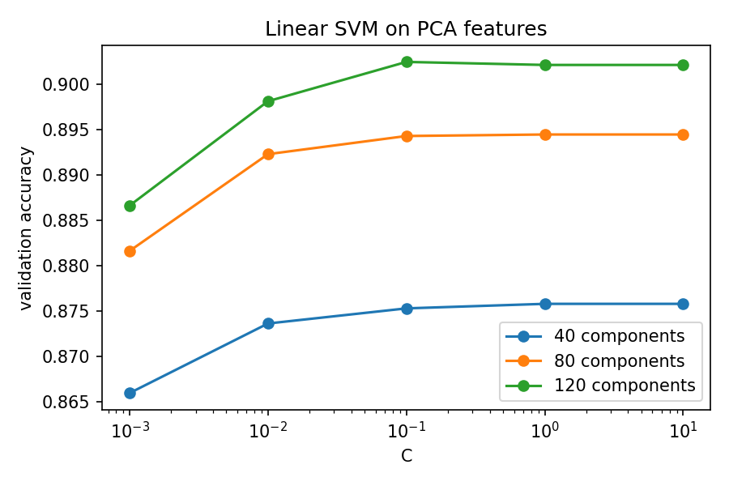

三条线从 $C=0.001$ 到 $C=0.1$ 都在上升，$C=0.1$ 之后几乎是水平的。绿线整段在橙线上面，橙线整段在蓝线上面，线与线的间隔大约 0.02，比每条线后半段的起伏大。主成分个数带来的差别大于 $C$。

RBF 的搜索画成三张热力图，从左到右是 40、80、120 个主成分。横轴是 $C$，纵轴是 $\gamma$ 相对 `scale` 的倍数，格子里的数是验证准确率，颜色从紫到黄表示从低到高。黑框标出全部格子里验证准确率最高的一组。

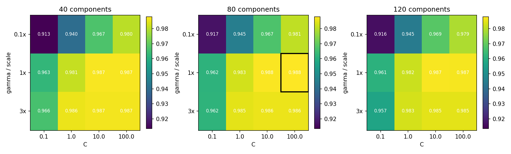

每张图左上角都是最深的一格，$C=0.1$、$0.1\times$ scale，验证准确率约 0.91。$C\ge 10$ 且 $\gamma$ 为 1 倍或 3 倍时，格子都在 0.985 以上，颜色连成一块。黑框在中间那张图的 $C=100$、1 倍 scale，格子上的数是 0.988，对应记录里的 0.9878。左右两张图里没有比它更高的格子。$C=100$、80 个主成分时，$\gamma$ 收到 0.1 倍，验证准确率降到 0.9807；放到 3 倍，降到 0.9857，支持向量增加到 19371。

线性 SVM 加大 $C$ 后，训练集效果更好，验证集几乎不变。换成更多主成分，验证准确率会上升，但仍然不超过原始像素上的线性 SVM。RBF 在 $C$ 太小或 $\gamma$ 远小于 scale 时验证准确率下降；$C$ 不太小、$\gamma$ 在 scale 附近时，相邻几组的验证结果接近。这次选中的设置就在这几组里面。

### 5.2 波士顿房价

#### 5.2.1 主实验

| 模型 | 支持向量 | 最佳验证 RMSE | 测试 RMSE | 测试 MAE | 测试 $R^2$ |
| --- | ---: | ---: | ---: | ---: | ---: |
| 普通最小二乘 | — | — | 5.0102 | 3.2254 | 0.6577 |
| linear_svr | 99 | 4.9246 | 5.1240 | 3.1079 | 0.6420 |
| rbf_svr | 279 | 3.5072 | 4.0898 | 2.5783 | 0.7719 |

最小二乘的测试 RMSE 是 5.0102，$R^2$ 是 0.6577，与线性回归实验在同一划分上的数字一致。

linear_svr 选中 $C=1$、$\varepsilon=4$。$\varepsilon=4$ 表示残差在 4000 美元以内不计入损失，管宽大约是目标标准差 9.19 的四成。323 条训练样本里有 99 条落在管外，成为支持向量。验证 RMSE 4.9246，测试 RMSE 5.1240，测试 MAE 3.1079，$R^2$ 0.6420。测试 RMSE 比最小二乘高 0.11，测试 MAE 比最小二乘低 0.12。平方损失 $(y-f(x))^2$ 计入每一个残差，$\varepsilon$ 管内的残差不计。所以按 RMSE 看，线性 SVR 不比最小二乘好；按 MAE 看，略好。

标准化之后，线性 SVR 系数绝对值最大的是 RM +4.07、DIS −3.00、LSTAT −2.50、PTRATIO −2.16。最小二乘里对应的是 RM +3.63、LSTAT −3.30、DIS −3.22。符号一致：房间数推高房价，低收入占比和到就业中心的距离压低房价。

线性函数没有房价的下界。测试集里真实房价 7.0 的样本被预测到 −5.2，真实房价 17.9 的样本被预测到 −0.4。被截断在 50 的测试样本有 3 个，平均预测 35.8，MAE 14.2；其中一条被预测到 22.2，残差约 −27.8。残差直方图偏在 0 的左侧。

下图左图是测试集的预测对真实值，黑线是 $y=x$。右图是残差 $\hat y-y$ 的直方图，0 处有一条竖线。

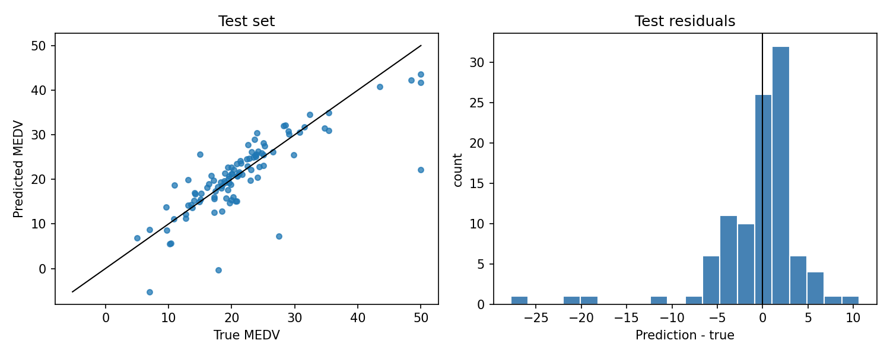

左图里中等价位的点大致沿着黑线，房价 50 附近的点掉到黑线下方，其中一个落到 22 附近。还有两个点的预测低于 0，对应真实房价 7.0 和 17.9。右图的峰在 0 的左侧，左尾一直伸到约 −28，就是那条被预测到 22.2 的样本。

rbf_svr 选中 $C=1000$、$\varepsilon=0.5$、$\gamma$ 等于 `scale`（0.0769）。验证 RMSE 3.5072，测试 RMSE 4.0898，测试 MAE 2.5783，$R^2$ 0.7719。训练 RMSE 只有 0.9297，训练 $R^2$ 0.9905。279 条支持向量占训练集的 86.4%。相对最小二乘，测试 RMSE 从 5.01 降到 4.09，$R^2$ 从 0.66 提到 0.77。同一划分上多层感知机的测试 RMSE 是 3.44。感知机最小化的是平方误差 $(y-\hat y)^2$，并在验证集变差时早停。RBF SVR 最小化 $\varepsilon$-不敏感损失，选中的 $C=1000$ 让绝大多数训练点变成支持向量，测试 RMSE 停在 4.09。

测试残差大多落在 $\pm 5$ 以内，比线性 SVR 对称。真实房价顶在 50 的 3 个样本平均预测 42.5，MAE 9.1，好于线性 SVR 的 14.2；其中一条仍被预测到 26.1，残差约 −23.9。真实房价 7.0 的样本被预测到 20.0，低价一端仍有一个超过 10 的正残差。

两张图的画法和线性 SVR 相同：左图是预测对真实值，右图是残差直方图。

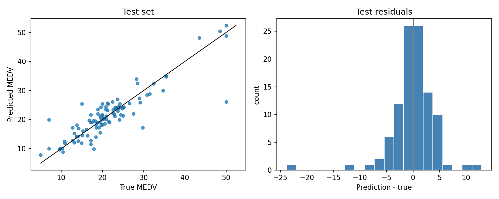

左图里 45 到 50 的几个点贴着黑线，只有真实值为 50 的一个点掉到 26 附近。低价一端有一个点明显高于黑线，就是真实房价 7.0、预测约 20 的那条。右图的主体在 −5 到 5，左右各有一条孤立的尾巴，分别对应残差约 −23.9 和 +13.0。预测没有再落到 0 以下。

线性 SVR 和普通最小二乘的整体误差接近。按 RMSE 看，线性 SVR 没有更好；按 MAE 看，略好一点。它是线性函数，会把房价预测成负数，也会把顶在上限的房价预测低。RBF SVR 可以表示非线性关系，预测更接近真实房价，高价样本的偏差小于线性 SVR，但仍大于多层感知机。它在训练集上的误差很小，测试集上又变大。房价被截断在上限的样本，最小二乘、线性 SVR 和 RBF SVR 都预测偏了。

#### 5.2.2 超参分析

线性 SVR 在 $\varepsilon=4$ 时验证 RMSE 最低。同一 $\varepsilon$ 下，$C=0.1$ 的验证 RMSE 是 4.9983，$C=1$ 降到 4.9246，$C=10$ 回到 4.9962，再加大 $C$ 就停在 5.00 附近，最低点在网格内部。

下图横轴是对数刻度的 $C$，纵轴是验证 RMSE。六条线是六个 $\varepsilon$，从 0.1 到 8。

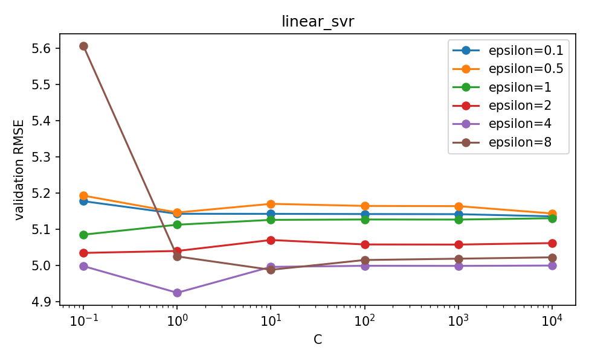

$\varepsilon=0.1$、0.5、1 三条线一直停在 5.1 到 5.2。紫色的 $\varepsilon=4$ 在 $C=1$ 降到 4.92，是整张图的最低点，两侧都回到 5.0 附近。棕色的 $\varepsilon=8$ 在 $C=0.1$ 时高达 5.60，$C$ 加大后降到 5.0 左右，但没有低于紫色线的最低点。

RBF SVR 固定 $\gamma=\gamma_{\mathrm{scale}}$ 时，验证 RMSE 随 $C$ 先降后升。选中的是 $\varepsilon=0.5$：$C=0.1$ 时 7.57，$C=1$ 时 5.43，$C=10$ 时 4.13，$C=100$ 时 4.00，$C=1000$ 时 3.51，$C=10000$ 时回到 4.65。最低点在 $C=1000$，不是网格端点。验证集只有 81 条，它选中了训练误差很小的那一组，测试 RMSE 因此比验证 RMSE 高 0.58。

下图只保留 $\gamma$ 等于 1 倍 scale 的结果，也就是验证集选中的那一档。横轴、纵轴和六条 $\varepsilon$ 线的含义与上一张相同。

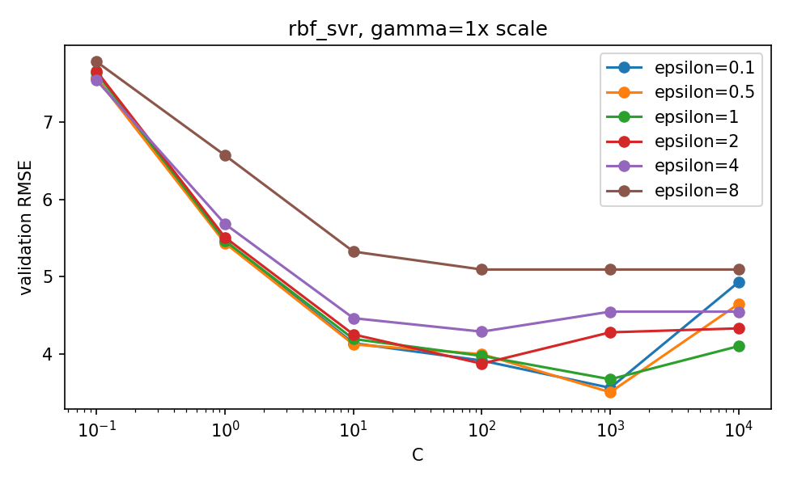

六条线在 $C=0.1$ 时都在 7.4 以上，然后一起下降。$\varepsilon=8$ 下降最慢，后半段停在 5.1 附近。$\varepsilon=0.1$ 和 $0.5$ 在 $C=1000$ 降到约 3.5，是图上的最低处；到 $C=10000$ 又升回 4.6 以上。$\varepsilon=1$ 的最低点略高，出现在同样的 $C=1000$。

线性 SVR 在 $C$ 不是太小时，验证误差差不多，差别主要来自 $\varepsilon$。$\varepsilon$ 很小或很大时，验证误差都高于中间那一档。RBF 的验证误差随 $C$ 先降后升：$C$ 太小时拟合不足，$C$ 过大时训练误差继续下降、验证误差回升。验证集选中的那一组，测试误差更高。验证集只有 81 条，这个选择不够稳。

## 6 总结

MNIST 上，原始像素的线性 SVM 测试准确率 91.80%。换成 120 个主成分后，线性 SVM 的测试准确率是 91.44%，降维没有提高分类准确率。RBF 在 80 个主成分上的测试准确率是 98.58%。RBF 能分开一部分线性边界分不开的写法。

房价任务上，线性 SVR 的测试 RMSE 是 5.12，测试 MAE 是 3.11。同一划分的最小二乘测试 RMSE 是 5.01、测试 MAE 是 3.23。$\varepsilon=4$ 的管不计小残差，RMSE 没有下降，MAE 略有下降。RBF SVR 的测试 RMSE 是 4.09，$R^2$ 是 0.77，仍高于多层感知机的 3.44。323 条样本里 279 条是支持向量，训练 RMSE 0.93，测试 RMSE 4.09。验证集选中的 $C=1000$ 使训练误差远小于测试误差。MEDV 在 50 处被截断，线性 SVR 和 RBF SVR 都还受这个截断影响。线性模型还会把低价样本预测到 0 以下。

```bash
python3 train.py --task mnist --model linear
python3 train.py --task mnist --model linear_pca
python3 train.py --task mnist --model rbf
python3 train.py --task boston --model linear_svr
python3 train.py --task boston --model rbf_svr
```

## 复现环境

Python 3.10.10，NumPy 2.2.6，scikit-learn 1.7.2，PyTorch 2.14.1。依赖见 `requirements.txt`。MNIST 由 torchvision 读取，放在 `data/MNIST`，没有则自动下载。波士顿房价表在 `data/boston_house_prices.csv`，缺失时从 StatLib 的原始文件解析。
