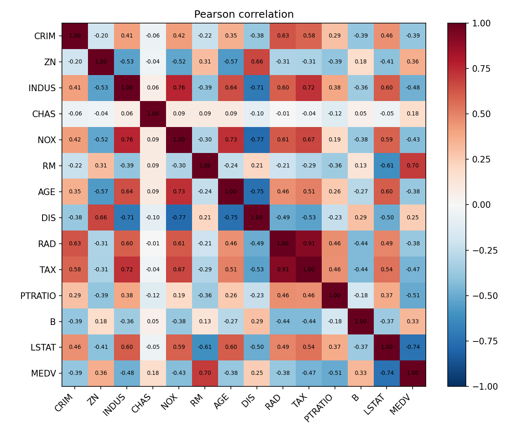
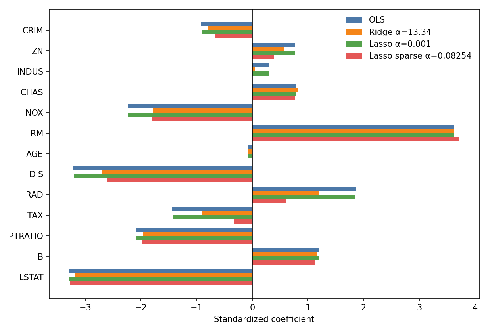
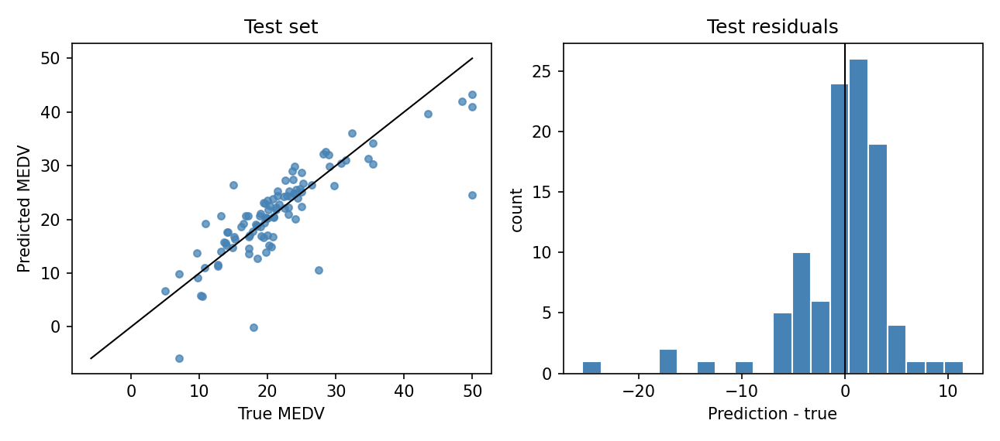
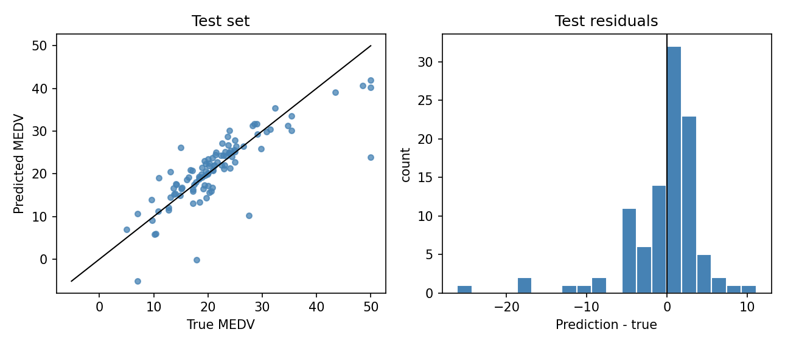
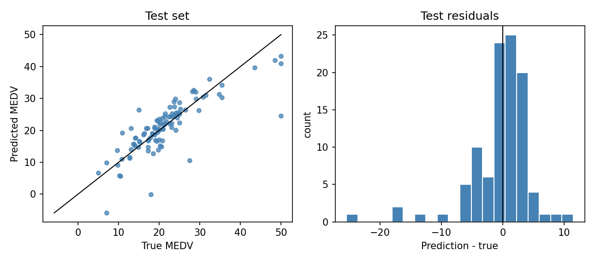
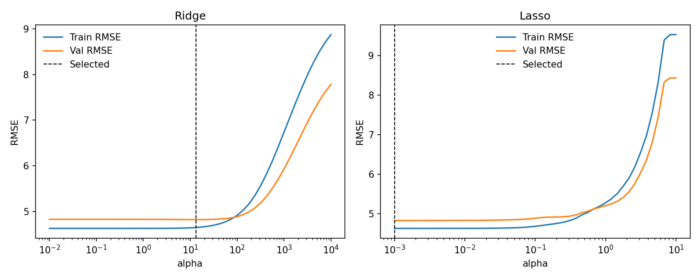
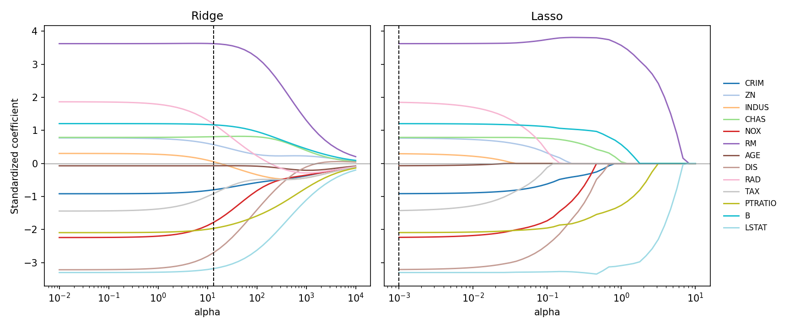

# 课程报告：线性回归用于房价预测

## 1 任务描述

基于波士顿房价数据，设计并实现岭回归和 Lasso 回归，预测自住房屋价格中位数。普通最小二乘没有正则项，作为对照。三个模型使用同一次划分和同一组标准化特征，差别只在惩罚项。数据与 Kaggle 上的 Boston House Prices、以及旧版 scikit-learn 的 `load_boston` 相同。当前环境的 scikit-learn 1.7 已移除该接口，因此直接读取原始的 506 条样本。

## 2 数据描述

数据来自 Harrison 与 Rubinfeld（1978），共 506 个城镇样本、13 个输入特征和 1 个目标。目标 MEDV 是自住房屋价格中位数，单位是千美元，范围 5 到 50，其中 16 条被截断在 50。全体样本均值 22.53，标准差 9.19，中位数 21.2。

| 特征 | 含义 |
| --- | --- |
| CRIM | 城镇人均犯罪率 |
| ZN | 占地 25000 平方英尺以上的住宅用地比例 |
| INDUS | 非零售商业用地比例 |
| CHAS | 是否邻接 Charles River，0/1 |
| NOX | 一氧化氮浓度 |
| RM | 住宅平均房间数 |
| AGE | 1940 年以前建成的自住房比例 |
| DIS | 到五个就业中心的加权距离 |
| RAD | 径向公路可达性指数 |
| TAX | 每万美元的全额财产税率 |
| PTRATIO | 城镇师生比 |
| B | $1000(B_k-0.63)^2$，$B_k$ 为城镇黑人人口比例 |
| LSTAT | 低收入人群占比 |
| MEDV | 房价中位数，千美元 |

和房价相关最强的是 LSTAT（$-0.74$）和 RM（$+0.70$），其次是 PTRATIO（$-0.51$）。CHAS 最弱，只有 $+0.18$。

| 特征 | 与 MEDV 的相关 | 特征 | 与 MEDV 的相关 |
| --- | ---: | --- | ---: |
| LSTAT | $-0.7377$ | RAD | $-0.3816$ |
| RM | $+0.6954$ | AGE | $-0.3770$ |
| PTRATIO | $-0.5078$ | ZN | $+0.3604$ |
| INDUS | $-0.4837$ | B | $+0.3335$ |
| TAX | $-0.4685$ | DIS | $+0.2499$ |
| NOX | $-0.4273$ | CHAS | $+0.1753$ |
| CRIM | $-0.3883$ | | |

特征之间有成团的相关。绝对值不低于 0.70 的有七对。13 个特征相关矩阵的条件数是 96.5。RAD 与 TAX 的相关达到 0.91，最小二乘会把这一对的系数拆开。样本数是特征数的二十多倍，Gram 矩阵可逆。

| 特征 | 特征 | 相关 |
| --- | --- | ---: |
| RAD | TAX | $+0.9102$ |
| NOX | DIS | $-0.7692$ |
| INDUS | NOX | $+0.7637$ |
| AGE | DIS | $-0.7479$ |
| NOX | AGE | $+0.7315$ |
| INDUS | TAX | $+0.7208$ |
| INDUS | DIS | $-0.7080$ |

下图是全部特征和房价的 Pearson 相关。红色是正相关，蓝色是负相关，颜色越深绝对值越大，格子里是相关系数，保留两位小数。



右下角 MEDV 这一行里，LSTAT 是最深的蓝色，RM 是最深的红色。RAD 和 TAX 交叉的格子是 0.91，是特征之间最深的一块。DIS 与 NOX、INDUS、AGE 都是深蓝，和房价本身只有 $+0.25$。CHAS 这一行、这一列几乎是白的，它和其余变量、也和房价都弱相关。

## 3 数据预处理

- 先划出 20% 作为测试集，再从剩余样本中划出 20% 作为验证集，得到 323 / 81 / 102。种子是 42，与多层感知机实验、支持向量机实验是同一次划分。
- `StandardScaler` 只在训练集上拟合，再作用到验证集和测试集。13 个特征的量纲差很大，TAX 的标准差约 168，CHAS 约 0.25。岭回归和 Lasso 的惩罚对尺度敏感，不标准化时，大尺度特征会被罚得更重。
- 目标保持原始的千美元单位。测试 RMSE 可以和后面的支持向量回归、多层感知机比较。

```python
x_trainval, x_test, y_trainval, y_test = train_test_split(
    features, target, test_size=0.2, random_state=42
)
x_train, x_val, y_train, y_val = train_test_split(
    x_trainval, y_trainval, test_size=0.2, random_state=42
)
scaler = StandardScaler()
x_train = scaler.fit_transform(x_train)
x_val = scaler.transform(x_val)
x_test = scaler.transform(x_test)
```

标准化之后，每个系数表示该特征增加一个训练集标准差时，房价中位数变化多少千美元。截距不参与惩罚。特征中心化之后，最优截距就是训练集目标均值 22.79。三个模型的截距都是这个数。

## 4 算法介绍

三种方法都拟合 $\hat y=b+x^\top w$。求解器写在 `train.py`，分别是 `fit_ols`、`fit_ridge` 和 `fit_lasso`。sklearn 的同名模型用来核对系数，下面的预测来自这三个求解器。核对结果：普通最小二乘的系数差为 0，选中的岭回归最大差 $2.7\times 10^{-15}$，选中的 Lasso 最大差 $1.4\times 10^{-7}$。

测试集上的 RMSE、MAE 和 $R^2$ 按

$$
\mathrm{RMSE}=\sqrt{\frac1n\sum_{i=1}^{n}(y_i-\hat y_i)^2},\quad
\mathrm{MAE}=\frac1n\sum_{i=1}^{n}|y_i-\hat y_i|
$$

计算。$R^2$ 用该集合上真实值的方差做分母。

```python
def regression_metrics(y_true, y_pred):
    return {
        "rmse": float(np.sqrt(mean_squared_error(y_true, y_pred))),
        "mae": float(mean_absolute_error(y_true, y_pred)),
        "r2": float(r2_score(y_true, y_pred)),
    }


def predict(features, coef, intercept):
    return features @ coef + intercept
```

**普通最小二乘**

最小化残差平方和

$$
\|y-Xw-b\mathbf{1}\|^2.
$$

先减去训练集均值，再用最小二乘解中心化后的方程。线性模型假设成立时这个解无偏。$X_c^\top X_c$ 的条件数较大时，共线特征上的系数会被拆得很散。它有 13 个系数和 1 个截距，共 14 个参数。

```python
def fit_ols(features, target):
    x_mean = features.mean(axis=0)
    y_mean = float(target.mean())
    centered = features - x_mean
    coef, *_ = np.linalg.lstsq(centered, target - y_mean, rcond=None)
    intercept = y_mean - float(x_mean @ coef)
    return coef, intercept
```

**岭回归**

Hoerl 与 Kennard（1970）在残差平方和上加系数的平方和。惩罚只加在 $w$ 上，截距不罚：

$$
\min_{w,b}\ \|y-Xw-b\mathbf{1}\|^2+\alpha\|w\|^2.
$$

闭式解把 $\alpha$ 加到 Gram 矩阵的对角线上：

$$
w=(X_c^\top X_c+\alpha I)^{-1}X_c^\top y_c.
$$

$\alpha>0$ 时矩阵一定可逆。系数被拉向 0，取值通常仍保持非零。相关特征上的系数会一起缩小，病态方向上的方差下降，换来一点偏差。$\alpha$ 取 $10^{-2}$ 到 $10^{4}$ 的 49 个对数间隔点。

```python
def fit_ridge(features, target, alpha):
    x_mean = features.mean(axis=0)
    y_mean = float(target.mean())
    centered = features - x_mean
    width = centered.shape[1]
    gram = centered.T @ centered
    gram.flat[:: width + 1] += alpha
    coef = np.linalg.solve(gram, centered.T @ (target - y_mean))
    intercept = y_mean - float(x_mean @ coef)
    return coef, intercept
```

**Lasso 回归**

Tibshirani（1996）把惩罚换成系数的绝对值。这里采用与 scikit-learn 相同的目标，残差项带 $1/(2n)$：

$$
\min_{w,b}\ \frac{1}{2n}\|y-Xw-b\mathbf{1}\|^2+\alpha\|w\|_1.
$$

绝对值在 0 处不可导，用循环坐标下降求数值解。设当前残差为 $r=y_c-X_c w$，第 $j$ 列的尺度 $z_j=\|x_j\|^2/n$。标准化之后 $z_j=1$。把该列当前的贡献加回残差，得到

$$
\rho_j=z_j w_j+\frac1n x_j^\top r,
$$

再做软阈值

$$
S(\rho,\alpha)=\mathrm{sign}(\rho)\max(|\rho|-\alpha,\ 0),\qquad
w_j\leftarrow S(\rho_j,\alpha)/z_j.
$$

$|\rho_j|\le\alpha$ 时该系数变成 0，所以 Lasso 可以做特征选择。$\alpha$ 取 $10^{-3}$ 到 $10^{1}$ 的 49 个对数间隔点。系数路径从大 $\alpha$ 暖启动到小 $\alpha$。49 个 $\alpha$ 都在 90 次迭代内收敛，选中的那一个用了 70 次。

岭回归惩罚的是残差平方和本身，Lasso 惩罚的是除以 $2n$ 之后的残差平方和，两个 $\alpha$ 不在同一尺度上。比较模型时用验证集 RMSE。

```python
def soft_threshold(value, threshold):
    magnitude = abs(value) - threshold
    if magnitude <= 0.0:
        return 0.0
    if value > 0.0:
        return magnitude
    return -magnitude


def fit_lasso(features, target, alpha, coef_init=None, max_iter=20000, tol=1e-8):
    n_samples, width = features.shape
    x_mean = features.mean(axis=0)
    y_mean = float(target.mean())
    centered = features - x_mean
    centered_target = target - y_mean
    column_scale = np.sum(centered * centered, axis=0) / n_samples
    if coef_init is None:
        coef = np.zeros(width, dtype=np.float64)
    else:
        coef = np.asarray(coef_init, dtype=np.float64).copy()
    converged = False
    used_iter = max_iter
    for iteration in range(1, max_iter + 1):
        max_delta = 0.0
        residual = centered_target - centered @ coef
        for index in range(width):
            scale = column_scale[index]
            if scale <= 1e-18:
                if coef[index] != 0.0:
                    residual += centered[:, index] * coef[index]
                    max_delta = max(max_delta, abs(coef[index]))
                    coef[index] = 0.0
                continue
            rho = float(np.dot(centered[:, index], residual) / n_samples + scale * coef[index])
            updated = soft_threshold(rho, alpha) / scale
            delta = updated - coef[index]
            if delta != 0.0:
                residual -= centered[:, index] * delta
                coef[index] = updated
                max_delta = max(max_delta, abs(delta))
        if max_delta < tol:
            converged = True
            used_iter = iteration
            break
    intercept = y_mean - float(x_mean @ coef)
    return coef, intercept, used_iter, converged


def lasso_path(features, target, alphas):
    order = np.argsort(alphas)[::-1]
    coef = np.zeros(features.shape[1], dtype=np.float64)
    slotted = [None] * len(alphas)
    for index in order:
        coef, intercept, used_iter, converged = fit_lasso(
            features, target, float(alphas[index]), coef_init=coef
        )
        slotted[index] = {
            "alpha": float(alphas[index]),
            "coef": coef.copy(),
            "intercept": intercept,
            "n_iter": used_iter,
            "converged": converged,
        }
    return [record for record in slotted if record is not None]
```

每个 $\alpha$ 只在训练集上拟合。验证 RMSE 最小的一组用于测试；差距小于 $10^{-6}$ 时取更大的 $\alpha$。测试集不参与选择。

```python
RIDGE_ALPHAS = np.logspace(-2, 4, 49)
LASSO_ALPHAS = np.logspace(-3, 1, 49)

def select_by_validation(records):
    best_rmse = min(record["val_rmse"] for record in records)
    candidates = [record for record in records if record["val_rmse"] <= best_rmse + 1e-6]
    return max(candidates, key=lambda record: record["alpha"])
```

## 5 实验结果及分析

### 5.1 主实验

若始终预测训练集均值 22.79，测试 RMSE 为 8.6613。最小二乘把它降到 5.0102，$R^2$ 为 0.6577。多层感知机实验和支持向量机实验在同一划分上引用的最小二乘，就是这一组数字。

| 模型 | $\alpha$ | 非零系数 | 验证 RMSE | 测试 RMSE | 测试 MAE | 测试 $R^2$ |
| --- | ---: | ---: | ---: | ---: | ---: | ---: |
| 预测训练集均值 | — | 0 | 8.4322 | 8.6613 | 6.2528 | $-0.0230$ |
| 普通最小二乘 | 0 | 13 | 4.8256 | 5.0102 | 3.2254 | 0.6577 |
| 岭回归 | 13.34 | 13 | 4.8203 | 5.0242 | 3.1739 | 0.6558 |
| Lasso | 0.001 | 13 | 4.8258 | 5.0105 | 3.2246 | 0.6577 |

训练、验证、测试三段的 RMSE 如下。岭回归的训练 RMSE 高于最小二乘，验证 RMSE 低于最小二乘。Lasso 的三段 RMSE 与最小二乘相差不超过 0.0003。

| 模型 | 训练 RMSE | 验证 RMSE | 测试 RMSE |
| --- | ---: | ---: | ---: |
| 预测训练集均值 | 9.5304 | 8.4322 | 8.6613 |
| 普通最小二乘 | 4.6269 | 4.8256 | 5.0102 |
| 岭回归 | 4.6464 | 4.8203 | 5.0242 |
| Lasso | 4.6269 | 4.8258 | 5.0105 |

标准化之后的系数如下。Lasso 这一列是验证集选中的 $\alpha=0.001$，13 个系数都还在。

| 特征 | 最小二乘 | 岭回归 | Lasso |
| --- | ---: | ---: | ---: |
| CRIM | $-0.92$ | $-0.80$ | $-0.91$ |
| ZN | $+0.77$ | $+0.57$ | $+0.77$ |
| INDUS | $+0.30$ | $+0.05$ | $+0.30$ |
| CHAS | $+0.79$ | $+0.81$ | $+0.79$ |
| NOX | $-2.24$ | $-1.78$ | $-2.23$ |
| RM | $+3.63$ | $+3.63$ | $+3.63$ |
| AGE | $-0.07$ | $-0.07$ | $-0.07$ |
| DIS | $-3.22$ | $-2.70$ | $-3.21$ |
| RAD | $+1.87$ | $+1.19$ | $+1.85$ |
| TAX | $-1.44$ | $-0.91$ | $-1.42$ |
| PTRATIO | $-2.09$ | $-1.96$ | $-2.09$ |
| B | $+1.21$ | $+1.17$ | $+1.21$ |
| LSTAT | $-3.30$ | $-3.18$ | $-3.30$ |

下图横轴是特征，每组三根柱子从左到右是最小二乘、岭回归和 $\alpha=0.001$ 的 Lasso，另外还有后面 5.2 节的稀疏参照点。纵轴是标准化系数。



RM 是最长的正柱，约 $+3.6$；LSTAT 和 DIS 是最长的两根负柱。岭回归的橙色柱在 RAD、TAX、INDUS、ZN 上明显短于蓝色柱，RM 和 LSTAT 几乎和蓝色一样长。绿色的 Lasso 柱和蓝色重合。AGE 的柱子贴着 0。

最小二乘里，RM 为 $+3.63$，LSTAT 为 $-3.30$，DIS 为 $-3.22$：房间数推高房价，低收入占比推低房价。DIS 和全体样本的简单相关是 $+0.25$，偏系数是 $-3.22$。DIS 与 NOX、INDUS、AGE 的相关在 $-0.71$ 到 $-0.77$，离就业中心远的城镇往往工业和污染指标更低；这些变量同时进入模型之后，距离本身对应更低的房价。INDUS 的简单相关是 $-0.48$，偏系数是 $+0.30$，共线把边际效应和偏效应拆开了。AGE 的偏系数只有 $-0.07$，是 13 个系数里最小的。

102 条测试样本里，最小二乘有 86 条残差落在 $\pm 5$ 以内。预测最小值是 $-5.89$，最大值是 43.26。真实房价顶在 50 的测试样本有 3 个，平均预测 36.3，MAE 为 13.7；其中一条被预测到 24.5，残差 $-25.5$。真实房价 7.0 的样本被预测到 $-5.9$，真实房价 17.9 的样本被预测到 $-0.04$。

下图左图是测试集的预测对真实值，黑线是 $y=x$。右图是残差 $\hat y-y$ 的直方图，0 处有一条竖线。



左图里 10 到 35 的点沿着黑线。房价 50 附近有两个点在 40 出头，另一个掉到 25 附近。还有两个点的预测低于或贴着 0，对应真实房价 7.0 和 17.9。真实房价 27.5 的一个点被预测到 10.6，落在黑线下方。右图的主体在 $-5$ 到 $5$，峰在 0 附近。左尾伸到约 $-25$，就是被预测到 24.5 的那条；右尾到约 $+11$，对应真实房价 15.0、预测 26.5。

岭回归选中 $\alpha=13.34$。验证 RMSE 从 4.8256 降到 4.8203，低 0.005。该权重的测试 RMSE 为 5.0242，$R^2$ 为 0.6558，测试 MAE 为 3.1739。测试 RMSE 比最小二乘高 0.014，测试 MAE 比最小二乘低 0.051。RM 仍是 $+3.63$，LSTAT 从 $-3.30$ 收到 $-3.18$。共线特征收得更多：INDUS 从 $+0.30$ 收到 $+0.05$，RAD 从 $+1.87$ 收到 $+1.19$，TAX 从 $-1.44$ 收到 $-0.91$，DIS 从 $-3.22$ 收到 $-2.70$。102 条测试样本里有 87 条残差落在 $\pm 5$ 以内。预测最小值是 $-5.16$，最大值是 42.01。三个被截断在 50 的样本平均预测 35.3，MAE 14.7；其中一条被预测到 23.8，残差 $-26.2$。真实房价 7.0 的样本被预测到 $-5.2$。

两张图的画法与最小二乘相同。



散点和最小二乘几乎是同一张图。中等价位仍沿着黑线，房价 50 的一个点掉到 24 附近，低价一端仍有预测低于 0 的点。右图的峰在 0 附近，主体仍在 $-5$ 到 $5$，左尾伸到 $-25$ 以左。把 RAD、TAX、INDUS 缩小之后，测试集上的大残差还在。

Lasso 的验证 RMSE 随 $\alpha$ 增大而上升，选中的是网格左端 $\alpha=0.001$。13 个系数都还在。测试 RMSE 为 5.0105，测试 MAE 为 3.2246，$R^2$ 为 0.6577，与最小二乘的 5.0102、3.2254、0.6577 相差在第四位小数。102 条里同样有 86 条残差落在 $\pm 5$ 以内。预测最小值 $-5.88$，最大值 43.23。被截断的 3 个样本平均预测 36.2，MAE 13.8；最大的一条残差是 $-25.5$，真实值 50，预测 24.5。



左图和最小二乘重合：同样是沿黑线的一团、50 处掉下去的一个点，以及两处接近或低于 0 的预测。右图的峰高、左右尾巴的位置也一样。$\alpha=0.001$ 的软阈值还没有把任何一个系数收到 0。

最小二乘的测试 RMSE 是 5.01。岭回归把它的共线系数缩小了，验证 RMSE 低 0.005，测试 RMSE 是 5.02，测试 MAE 从 3.23 降到 3.17。Lasso 在这个网格上选了最小的惩罚，测试结果和最小二乘相同。三个线性模型都会把房价预测成负数，也都会把顶在 50 的样本预测到 25 附近。同一划分上，线性 SVR 的测试 RMSE 是 5.12，RBF SVR 是 4.09，64-32 的多层感知机是 3.44。岭回归和 Lasso 改的是共线系数的大小，测试 RMSE 仍在 5.0 附近。

### 5.2 正则系数

岭回归的验证曲线在 $\alpha=13.34$ 最低。$\alpha$ 从 1 到 32，验证 RMSE 都在 4.820 到 4.825 之间，最低点很平。81 条验证样本分不出更细的差别。$\alpha=100$ 时验证 RMSE 升到 4.8848，INDUS 从 $+0.05$ 变成 $-0.34$，最小二乘给出的正偏系数随惩罚强度改变符号。$\alpha=10^4$ 时训练 RMSE 8.8738，验证 RMSE 7.7820，系数都靠近 0，还没有退回到预测均值的 9.53 和 8.43。

| $\alpha$ | 训练 RMSE | 验证 RMSE |
| ---: | ---: | ---: |
| 0.01 | 4.6269 | 4.8256 |
| 1 | 4.6271 | 4.8248 |
| 13.34 | 4.6464 | 4.8203 |
| 100 | 4.9120 | 4.8848 |
| 1000 | 6.7351 | 5.9295 |
| 10000 | 8.8738 | 7.7820 |

Lasso 从 $\alpha=0.001$ 起，验证 RMSE 单调上升。系数按下面的顺序变成 0：AGE（$\alpha=0.032$），INDUS（0.038），TAX（0.12），RAD（0.18），ZN（0.22），NOX（0.46），CRIM 与 DIS（0.83），CHAS（1.21），B（1.78），PTRATIO（3.16）。最后留下的是 RM 和 LSTAT。$\alpha=3.16$ 时这两项还在，分别是 $+2.42$ 和 $-2.30$，验证 RMSE 6.0430。$\alpha\ge 8.25$ 时它们也变成 0，训练 RMSE 9.5304、验证 RMSE 8.4322，与预测训练集均值相同。

| $\alpha$ | 非零系数 | 训练 RMSE | 验证 RMSE | 已经为 0 的特征 |
| ---: | ---: | ---: | ---: | --- |
| 0.001 | 13 | 4.6269 | 4.8258 | — |
| 0.032 | 12 | 4.6341 | 4.8380 | AGE |
| 0.038 | 11 | 4.6370 | 4.8412 | AGE、INDUS |
| 0.0825 | 11 | 4.6636 | 4.8696 | AGE、INDUS |
| 0.18 | 9 | 4.7371 | 4.9118 | 再加 RAD、TAX |
| 1 | 5 | 5.2742 | 5.2006 | 再加 CRIM、ZN、NOX、DIS |
| 3.16 | 2 | 6.5597 | 6.0430 | 只剩 RM、LSTAT |
| 8.25 | 0 | 9.5304 | 8.4322 | 全部 |

在验证 RMSE 不比最优点高过 0.05 的模型中，非零系数最少的是 $\alpha=0.0825$，去掉 INDUS 和 AGE。验证 RMSE 4.8696，测试 RMSE 5.1097，测试 MAE 3.2422，$R^2$ 0.6440。AGE 的偏系数只有 $-0.07$。INDUS 的偏系数和简单相关反号。去掉这两项之后，测试 RMSE 从 5.0105 升到 5.1097。这个点的测试残差仍有 87 条落在 $\pm 5$ 以内，预测最小值 $-5.10$。被截断的 3 个样本平均预测 35.1，MAE 14.9。

下图横轴是对数刻度的 $\alpha$，纵轴是 RMSE。蓝线是训练集，橙线是验证集，黑色虚线是验证集选中的 $\alpha$。左图是岭回归，右图是 Lasso。



左图在 $10^{-2}$ 到 $10^{1}$ 几乎是两条水平线，训练 RMSE 约 4.63，验证 RMSE 约 4.82。虚线落在这段平线的右端。$\alpha$ 超过 $10^{2}$ 之后两条线一起上升，训练线升得更高，到 $10^{4}$ 时训练约 8.9、验证约 7.8。右图的虚线贴在网格最左边。$\alpha$ 从 $10^{-3}$ 到 $10^{-1}$，两条线也几乎水平；过了 $10^{-1}$ 开始上升，到 $\alpha\approx 8$ 时训练 RMSE 跳到 9.53，验证 RMSE 落到 8.43，之后保持水平。这是系数全部变成 0、模型退化为截距的位置。

下一张把 13 个特征的系数随惩罚强度的变化画在一起。横轴是 $\alpha$，越往右罚得越重；纵轴是标准化之后的系数，一条彩色线代表一个特征。灰色横线是 0，黑色虚线是验证集选中的 $\alpha$。



纵轴是标准化以后的系数。线在 $+3.6$，表示这个特征比训练集平均水平高一个标准差时，预测房价大约高 3600 美元。线落到 0，这个特征就不再进入预测。最高的一条是 RM，房间越多，房价越高；最低的一条是 LSTAT，低收入占比越高，房价越低。

横轴向右，$\alpha$ 变大，惩罚变重，系数往灰色的 0 线靠。惩罚足够大时，预测会接近一律报平均房价。

左图是岭回归。虚线左边各条线几乎是平的，和最小二乘差不多。虚线在 $\alpha=13.34$，是验证集选中的位置。这里 RM 还在 $+3.6$ 附近，LSTAT 还在 $-3.3$ 附近。先往 0 收的是 RAD、TAX、DIS、INDUS。公路可达性和房产税的相关有 0.91，这几项有重叠，岭回归把它们的系数一起缩小。曲线弯向 0，中途不会停在 0 上；再往右，所有系数才一起收到 0。选中的这一点上，验证 RMSE 从 4.826 降到 4.820，测试 RMSE 仍是 5.02。

右图是 Lasso。系数一条一条贴到 0 上，贴住就表示该特征被去掉。AGE 最先到 0，接着是 INDUS。RAD 和 TAX 在 $\alpha$ 大约 0.1 时一起变成 0。RM 和 LSTAT 留到最后，大约 $\alpha=8$ 时也变成 0。这时 13 个系数都是 0，预测回到训练集的房价均值，验证 RMSE 回到 8.43。

右图的虚线在最左边，$\alpha=0.001$。这里还没有系数变成 0，预测和最小二乘几乎一样，测试 RMSE 是 5.01。$\alpha=0.0825$ 时 AGE 和 INDUS 已经是 0，测试 RMSE 升到 5.11。Lasso 给出了系数变成 0 的顺序；按验证误差来选，它停在还没开始删特征的那一端。

房间数和低收入占比这两条线离 0 最远，惩罚加大以后也留得最久。RAD 和 TAX 的系数会缩小，在 Lasso 里还会变成 0。样本 323 条、特征 13 个，加上惩罚之后，测试误差仍在 5 个千美元左右。

## 6 总结

三种方法都把房价写成特征的加权和。测试误差接近，都低于一律报平均价。

普通最小二乘里，房间多、离就业中心近，房价高；低收入人口占比高，房价低。公路指数和房产税高度相关，前者的系数是正的，后者是负的。岭回归和 Lasso 选出来的预测都离这个结果不远。

岭回归不去掉特征，把公路指数、房产税、工业用地和就业距离的系数缩小，房间数和低收入占比几乎不动。测试误差没有降下来，平均绝对误差略小。

Lasso 按验证误差选出的模型里，13 个系数都还在，预测和最小二乘几乎一样。惩罚加大以后，房龄和工业用地先变成 0，房间数和低收入占比最后才变成 0。去掉前两项，测试误差变大。惩罚再加大，模型只剩截距，预测回到平均房价。

和后面的支持向量回归、多层感知机相比，这三种方法的系数正负对应房价升高还是降低。它们都是直线：价格被截断在上限的房子会被估低，很便宜的房子可能被估成负数。RBF 核的支持向量回归和多层感知机能拟合弯曲的关系，预测更接近真实房价。

```bash
python3 train.py
```

## 复现环境

Python 3.10.10，NumPy 2.2.6，scikit-learn 1.7.2。依赖见 `requirements.txt`。波士顿房价表在 `data/boston_house_prices.csv`，缺失时从 StatLib 的原始文件解析。
